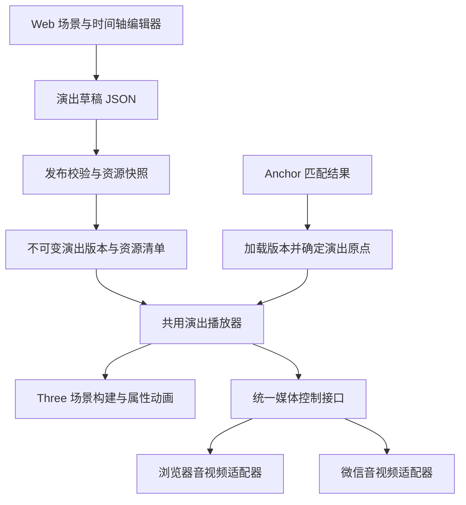

# Web 多媒体演出编辑器与 Three.js 运行时改造方案

更新日期：2026-10-09  
状态：设计提案，尚未实现。本文基于管理端源码与小程序当前 VisionKit＋Three.js 工作区（包含尚未提交的迁移改动），不表示线上已具备演出编辑能力。

## 1. 目标与方案

在管理端嵌入一个演出编辑器，让用户复用已有素材库，在三维空间中摆放文字、图片、模型、音频和视频，并用时间轴编排出现、运动和播放顺序。小程序识别到 anchor 后，加载并播放该 anchor 绑定的已发布演出。

组件化自建路线的候选组合（先完成第 11 节的现成平台验证，再决定是否实施）：

- **编辑界面**：现有 React／React Three Fiber／drei，加可替换的时间轴组件。
- **动画执行**：复用 Three.js 的 `AnimationClip`、`KeyframeTrack`、`AnimationMixer`。
- **演出协议**：自行定义带版本号的 JSON，描述素材实例、空间布局、属性轨道和媒体片段。
- **两端共用**：演出协议、时间求值、场景对象构建规则；浏览器和微信分别实现资源、文字画布、音视频适配器。
- **后端**：沿用阿里云 Next.js＋PostgreSQL／PostGIS＋OSS，增加演出草稿、发布版本和 anchor 绑定。

复用现成组件可以减少时间轴交互和动画插值的开发量，但素材绑定、发布流程、媒体同步、微信适配仍是本项目需要实现的部分。补充调研已确认 Mattercraft 等平台能够制作接近目标的多媒体三维演出；尚未核实到同时满足“编辑器嵌入本管理端＋保留现有 Three r186／VisionKit 单画布＋微信原生音视频”的开箱即用方案。详见第 11 节，不能把接入限制理解为市场上没有相似产品。

## 2. 现状与差距

| 部分 | 当前能力 | 本次改造需要补充 |
|---|---|---|
| Web 技术栈 | React 19、R3F、drei；Three 依赖范围为 `^0.183.2` | 多素材场景预览、操作工具、时间轴；与小程序统一 Three 精确版本 |
| 小程序渲染 | VisionKit 提供相机与跟踪，Three `0.186.1` 在单画布渲染 | 接入共用演出播放器，保留现有相机与渲染循环 |
| 素材关系 | `asset.anchor_id` 关联匹配点，已有五类媒体素材 | 区分素材源与演出实例，支持同一 asset 在一场演出中多次使用 |
| 模型 | 当前实例化后会播放所有 GLB 动画 | 选择动画片段、安排开始时间、循环和播放速度 |
| 文字 | 小程序动态排版并生成纹理、几何背景 | Web 复用布局规则；内容与样式更新、进出场动画 |
| 音频 | 微信原生音频播放，已有距离衰减与点击控制 | 时间轴调度、裁剪、统一暂停／跳转／释放 |
| 视频 | 微信解码器输出纹理，支持普通视频与上下分区透明视频 | 公开完整播放控制接口，处理准备状态、跳转和音画同步 |
| 空间排列 | 业务素材存在自动分布、朝向、斥力或默认动画 | 演出实例采用显式局部坐标，明确每个变换属性的控制方 |

主要源码入口：

- Web 素材定义：[`app/manage/types.ts`](../app/manage/types.ts)。
- Web 模型预览：[`AssetModelPreview.tsx`](../app/manage/components/AssetEditor/previews/AssetModelPreview.tsx)。
- Web 素材上传：[`lib/upload/`](../lib/upload/README.md)。
- 小程序仓库：`xr-frame-plant-trees`，与本仓库独立；当前本机位于 `/Users/wangzhewei/WeChatProjects/xr-frame-plant-trees`。
- 小程序运行时：`miniprogram/lib/three-runtime/{ar-runtime,resources,text,video}.js`。
- 小程序素材与匹配：`miniprogram/components/xr-start/assets/`、`matching/`。

管理端地图仍是 Cesium iframe，演出编辑器使用独立的 Three 局部场景视口。地图负责地点和 anchor，演出视口负责米制局部布局，两者不混用坐标和相机控制。

## 3. 编辑器选型

### 3.1 自建路线候选：React Timeline Editor 作为时间轴界面

[`@xzdarcy/react-timeline-editor`](https://github.com/xzdarcy/react-timeline-editor) 提供基于行和片段的 React 时间轴，适合接入开始／结束时间、拖动和自定义效果。采用 MIT 许可；本次核对到的 npm 最新版为 `1.0.0`，发布于 2026-01-25，声明 React／React DOM `>=18`。

它的维护频率不算高，也不是完整的三维关键帧编辑器。首轮验证需要覆盖本项目的 React 19、Next.js 客户端动态加载、拖动缩放、撤销与重做、时间拖拽预览。声明兼容不等于已通过项目实测。

只通过适配模块把演出数据映射为组件的行和片段。不要将组件内部状态作为数据库协议，也不要把 React、DOM 或整个编辑器打包进小程序。属性关键帧入口和缓动预设需在此基础上扩展；完整曲线编辑器放到后续阶段。

### 3.2 其他方案的定位

| 方案 | 适用能力 | 本项目判断 |
|---|---|---|
| [Three.js 动画系统](https://threejs.org/docs/pages/AnimationMixer.html) | 对象动画、GLB 动画、时间跳转与混合 | 作为两端动画执行基础；本身不提供完整编辑 UI |
| [pmndrs/timeline](https://pmndrs.github.io/timeline/tutorials/7-vanilla) | 用代码组合三维行为，支持普通 Three 项目 | 可作为后续行为编排参考；不是可直接使用的可视化多媒体编辑器 |
| [OpenCut](https://github.com/OpenCut-app/OpenCut#status) | 视频剪辑产品 | 官方当前正重写，新的 Editor API 在计划中；改造为三维 AR 演出不是低成本接入 |
| Blender＋GLB | 外部制作模型、骨骼和模型内部动画 | 保留为模型制作入口，Web 负责选择片段并与其他媒体编排 |

本方案不依赖 Theatre.js。选型理由是希望复用现有 Three 链路、控制后续维护范围，同时保持编辑器可替换；不能把“换了时间轴库”视为已解决多媒体运行时。

## 4. 用户操作流程

1. 在管理端选中 anchor，进入“编辑演出”。
2. 从现有素材库拖入素材，生成独立的演出实例。
3. 在三维视口中移动、旋转、缩放；支持吸附、数值输入与原点重置。
4. 在下方时间轴设置出现区间、动画关键帧、模型动画和音视频片段。
5. 拖动播放头预览指定时刻，播放整场演出，保存草稿。
6. 执行资源与兼容性检查，发布为不可变版本。
7. 小程序匹配 anchor，加载对应版本，准备资源，放置整场演出并开始播放。

界面采用“左侧素材／场景树、中间三维视口、右侧属性、下方时间轴”。布局、组件与 Storybook 遵循 [`design-system.md`](./design-system.md) 和 [`ui/storybook.md`](./ui/storybook.md)。

编辑器预览可绕场景观察；小程序中的用户相机始终由 VisionKit 控制。第一版不允许演出时间轴覆盖 AR 相机姿态。

## 5. 演出数据协议

### 5.1 三个核心概念

- **Asset**：素材库中的原始内容、文件和默认配置。
- **Instance**：某个 asset 在演出中的一次使用，拥有独立 ID、变换和样式覆盖。
- **Performance**：一组实例、时间轴轨道和播放规则。第一版一个 anchor 绑定一个演出，一个演出归属一个工作区。

原 asset 的 GPS、默认缩放等不随演出编辑直接修改。演出内使用局部坐标；实例覆盖配置独立保存。`instanceId` 与 `assetId` 必须分开，才能同时摆放同一模型的多个副本。

### 5.2 协议约定

| 字段／规则 | 建议约定 |
|---|---|
| `schemaVersion` | 协议版本，第一版为 `1`；客户端拒绝执行不支持的版本 |
| `duration`、片段时间 | 秒；编辑器可显示帧刻度，播放以时间为准，与设备帧率解耦 |
| 空间单位 | 米；右手坐标，Y 向上，局部正前方为 -Z |
| 旋转 | 保存归一化四元数 `[x,y,z,w]`；UI 可用角度输入，运行时做球面插值 |
| 轨道目标 | `instanceId`＋受支持的属性名，不接受任意脚本或对象路径执行 |
| 片段区间 | `[start,end)`；循环、结束保留和停止释放分别有明确语义 |
| 素材配置 | 草稿引用 asset，发布时冻结文件版本、文字内容、样式和所需元数据 |
| 资源清单 | 发布时生成 manifest，包含类型、对象标识／hash、时长、必要能力及加载优先级 |

下面是概念示例，ID 为占位符，尚不是已实现的 API 合约。发布版本还需携带资源 manifest 和素材快照。

```json
{
  "schemaVersion": 1,
  "duration": 12,
  "placement": { "mode": "camera_forward", "distanceMeters": 2 },
  "playback": { "loop": false, "endBehavior": "hold" },
  "instances": [
    {
      "id": "title-1",
      "assetId": "asset-title",
      "transform": {
        "position": [0, 0.8, 0],
        "quaternion": [0, 0, 0, 1],
        "scale": [1, 1, 1]
      }
    },
    {
      "id": "voice-1",
      "assetId": "asset-voice",
      "audioMode": "background"
    }
  ],
  "tracks": [
    {
      "kind": "property",
      "instanceId": "title-1",
      "property": "opacity",
      "interpolation": "linear",
      "keys": [{ "time": 0, "value": 0 }, { "time": 1, "value": 1 }]
    },
    {
      "kind": "media",
      "instanceId": "voice-1",
      "clips": [
        { "start": 2, "end": 10, "sourceIn": 0, "sourceOut": 8, "loop": false }
      ]
    }
  ]
}
```

示例的前方 2 米仅用于说明可配置放置策略，不是已经上线的默认值。第一版音视频按原速播放；模型片段可以单独定义播放速度。任意媒体倍速、反向播放与复杂时间重映射不在第一版范围内。

### 5.3 轨道分类

| 轨道 | 控制内容 | 实现方式 |
|---|---|---|
| 属性轨道 | 位置、旋转、缩放、整体透明度 | 编译为 Three 关键帧轨道，特殊材质通过类型适配器绑定 |
| 可见性轨道 | 出现与隐藏区间 | 按当前时间确定状态；隐藏不自动等于停止音频 |
| 模型动画轨道 | GLB clip、片段区间、循环、速度 | `AnimationMixer`／`AnimationAction`；外层位移与内部骨骼动画分离 |
| 媒体轨道 | 音视频播放区间、源片段截取、循环、音量 | 媒体适配器控制；由统一时钟调度 |
| 离散属性轨道 | 文案或样式切换 | 仅在值变化时更新资源，不每帧重新生成文字纹理 |

第一版同一实例、同一属性的重叠轨道在发布时拒绝；同一媒体实例同一时刻只播放一个源片段。模型 clip 第一版按顺序切换，跨片段混合后续再开放，避免含糊的覆盖和混音规则。

## 6. 多媒体具体处理

| 类型 | 第一版编辑能力 | 运行时注意事项 |
|---|---|---|
| 文字 | 内容、颜色、背景、尺寸、显隐、移动、缩放、淡入淡出 | 复用动态排版与纹理方案；整体透明度覆盖文字与装饰；固定字体和排版规则后比较两端效果 |
| 图片 | 米制尺寸、位置、旋转、显隐、透明度 | 保持宽高比；明确深度遮挡与透明排序；共享纹理、独立实例材质 |
| 模型 | 位置／旋转／缩放、GLB 动画选择与播放区间 | 停止自动播放全部 clip；统一归一化基准、枢轴与尺寸；每实例独立动画状态 |
| 音频 | 截取、开始时间、循环、音量曲线 | 明确“背景音”与“随位置衰减”两种模式；音量曲线与距离衰减相乘，不能互相覆盖 |
| 视频 | 普通／透明视频、尺寸、播放区间、显隐、淡入淡出 | Web 与微信复用透明视频 UV／alpha 规则；微信封装补齐状态与 seek；统一处理视频声音 |

当前视频采用解码后 RGBA 纹理上传。多路高分辨率视频会增加解码、内存带宽和纹理上传成本。第一版建议先限定同时播放一条视频，这是产品性能预算，不代表微信平台的固定上限；放宽前必须真机测量。

当前音频存在 `.webm` 对应同名 `.m4a` 的历史约定。演出发布清单应记录已准备好的实际播放资源，避免播放器靠替换扩展名猜测转码结果。媒体预处理继续复用上传与 OSS 链路。

模型兼容性以小程序实现为准。现有 Web 预览能够加载的压缩模型，不代表小程序支持：当前小程序尚未完成必需 Draco／meshopt、KTX2-only 等资源的完整加载支持。发布检查应拒绝不兼容资源或要求先生成兼容版本。

文字内容在运行时动态生成，保留现有几何背景方案。第一版只做整体运动和透明度；打字机、逐字动画、复杂排版可以后续增加，不能通过每帧整张文字纹理重绘实现。

## 7. 两端共用运行时



### 7.1 模块边界

- `performance-schema`：协议类型、默认值、校验与版本迁移，无 DOM／微信依赖。
- `performance-core`：时间映射、状态机、轨道编译、取消与生命周期控制。
- `performance-three`：构建实例、绑定 Three 属性、选择 GLB clip、释放实例资源。
- `performance-web`：浏览器资源、文字 Canvas、音视频与编辑预览适配。
- `performance-wechat`：微信下载、离屏 Canvas、音频、视频解码器与应用生命周期适配。

以上是建议模块边界，不是现有目录。两端通过固定版本的共享包及构建产物复用核心代码，避免手工复制出两套逻辑；小程序仍沿用现有构建方式。第一版可以在本仓库建立共享源模块，再接入小程序构建脚本，不要求先合并两个仓库。

R3F 负责 Web 编辑器的交互与渲染集成，共用场景构建模块返回普通 Three 对象。小程序继续由原生帧回调驱动；不要为了播放演出再创建第二套渲染循环。

### 7.2 统一时钟与媒体同步

建议播放器接口：`prepare`、`play`、`pause`、`seek`、`stop`、`dispose`。媒体接口另外提供 `ready`、`currentTime`、`duration`、`setVolume`、错误及结束事件，并标明设备实际支持的能力。

1. 必需资源达到可播放状态后启动统一时钟。不要按“哪个文件先加载完”分别开始计时。
2. Three 属性动画按演出绝对时间求值，GLB 动画换算为对应片段的局部时间。统一时钟不能用渲染帧数累加，也不能因截断大帧间隔而长期落后媒体。
3. 音视频进入片段时播放，退出时停止；跳转时按 `sourceIn + (演出时间 - start)` 定位，循环片段按源区间取模。
4. 不每帧对音视频执行 seek。初始启动、用户跳转和明显漂移时才校正；首次验证可把 150 ms 作为待调试的漂移阈值，实测后确定。
5. 编辑器拖动播放头时合并异步 seek，只应用最后一次结果。属性求值可立即更新，媒体帧到达后再展示，避免旧 seek 覆盖新位置。
6. 第一版必需媒体缓冲时暂停整场演出并显示加载状态；可选素材可跳过并记录。不能让媒体停止而模型继续推进，导致旁白和动作脱节。
7. 页面隐藏或跟踪失效时暂停整场。跟踪坐标系重建后清场并重新放置；单纯暂停后恢复则重新检查媒体时间。

微信原生媒体的异步准备、seek 和解码误差仍需 iOS／Android 验证。统一时钟是同步策略，不代表已经具备逐帧精确的音画同步。

`endBehavior=hold` 表示冻结最终视觉状态，媒体结束后停止；`stop`／`dispose` 表示停止媒体并清理实例。正常播放到结尾和识别逻辑清场必须走不同的生命周期入口。

### 7.3 空间原点与变换控制

整场演出使用一个根节点：

```text
VisionKit 世界坐标
└─ performanceRoot（本次放置的固定变换）
   ├─ instanceRoot（演出局部坐标与属性动画）
   │  └─ modelRoot（GLB 内部动画）
   └─ 其他文字／图片／媒体实例
```

匹配成功时记录放置所需的相机姿态，完成资源准备后仍使用该次快照，避免网络加载期间用户移动导致整场演出改变落点。演出放置后，根节点固定在本次 AR 会话坐标中，不持续跟随相机。

首版可选“相机水平前方”或“平面命中点”作为原点策略。平面策略在没有有效命中时明确等待；不要静默退回另一个策略。演出实例的变换由演出播放器统一控制，自动分散、斥力、朝向相机和默认旋转仅在显式选择相应效果时参与，并规定作用节点与顺序。

SAGE 目前只识别地点，不返回持久化六自由度位姿。该方案可以保证一场演出内部的相对布局，不能保证不同用户、不同会话的同一模型都贴合现实中的同一块墙面。后续接入空间重定位时可替换根节点定位来源，保留演出局部坐标与时间轴。

## 8. 后端、发布与兼容

### 8.1 存储建议

建议新增以下实体，命名遵循当前单数表约定。下表为待实现设计，不要求立即执行迁移。

| 实体 | 用途 |
|---|---|
| `performance` | 工作区归属、名称、草稿 JSONB、草稿修订号、当前发布版本 |
| `performance_version` | 不可变演出 JSONB、素材快照、manifest、协议版本、发布时间 |
| `anchor_performance` | anchor 与演出的绑定，第一版每个 anchor 最多一条 |
| `performance_resource` | 发布版本与 OSS 对象的引用，供保留、删除与清理检查 |

保存草稿使用修订号做冲突检测，避免多个编辑窗口互相覆盖。发布前校验实例引用、轨道类型、数值范围、媒体时长、动画 clip 名、资源兼容性及工作区归属。发布快照与资源引用在事务中写入后，再原子更新当前版本指针。

发布版本不能只存 `assetId` 再实时读取最新 asset，否则后续改文案、替换文件会改变已发布演出。需要冻结文字与样式，并引用不可变媒体对象；如某类资源采用覆盖写入，应先生成版本化对象。

现有删除与 OSS 清扫逻辑必须纳入 `performance_resource`。资产行被删或文件被替换后，只要已发布版本仍引用对应对象，就应保留；删除演出版本时再释放引用。复用文件去重，不为每个实例复制一份媒体。相关入口见 [`asset-storage-lifecycle.md`](./asset-storage-lifecycle.md)，实际存储实现以当前 OSS／PostgreSQL 源码与 [`data-layer.md`](./data-layer.md) 为准。

### 8.2 API 建议

以下路径仅为设计草案，实施时保持现有响应风格和权限边界。

| 操作 | 建议接口 | 访问规则 |
|---|---|---|
| 新建演出 | `POST /api/workspaces/[id]/performances` | 登录并校验目标工作区的素材管理权限 |
| 读取／保存草稿 | `GET/PATCH /api/performances/[id]` | 按所属组织、工作区执行现有读写权限检查 |
| 发布 | `POST /api/performances/[id]/publish` | 登录、写权限、完整资源与协议校验 |
| 绑定 anchor | `PUT /api/anchors/[id]/performance` | 校验 anchor、演出及所引用素材的可用范围 |
| 小程序读取已发布版本 | `GET /api/miniapp/performances/[id]/versions/[version]` | 匿名，只返回可用的已发布版本，不暴露草稿 |

识别相关接口继续匿名。新的演出管理写接口沿用现有管理端权限，不扩大匿名写入范围。公开读取协议版本与内容版本分开管理；客户端只缓存不可变的已发布内容，当前版本指针需能及时刷新。

识别成功响应可增量增加 `performance` 引用（演出 ID、发布版本、协议版本），保留已有 `assets` 字段。第一版先单独获取演出版本，避免把大量时间轴数据加入每次识别响应；后续再按实际延迟优化预取。

### 8.3 接入现有识别流程

保持现有业务规则：进入识别后等待 3 秒，每 1 秒发起取图／识别，单次匹配成功即停止后续取图；相对成功时的位置移动 1.5 米后清场并重新等待 3 秒，转动不重新触发。

- 有兼容的已发布演出：匹配成功后进入演出加载与播放流程。
- 没有绑定演出：继续使用当前关联素材展示流程。
- 老版本小程序：忽略新增演出字段，继续使用原 `assets` 结果。
- 不支持的协议：显示明确状态，并按预先定义的兼容策略展示旧素材；资源加载错误不伪装成“没有演出”。

模式切换、位移触发清场和退出页面时，统一取消识别、加载、seek 与播放器任务，并释放文字、模型、纹理、音视频。沿用现有 generation／epoch 思路，使晚到的异步结果不能把旧演出重新放回场景。

## 9. 分阶段实施与验收

| 阶段 | 工作范围 | 验收要求 |
|---|---|---|
| A：兼容性验证 | 统一 Three 版本，验证时间轴组件与 React 19；一份固定 JSON 驱动 Web 和小程序 | 同一场景的尺寸、枢轴、透明视频规则一致；五类素材可加载并完整释放；确认音视频 seek 能力 |
| B：最小编辑器 | 素材库拖入、实例树、三维变换、片段时间编辑、基础关键帧、撤销重做 | 能编辑并回读一段含五类素材的演出；任意时间预览与从头播放到该时刻的状态一致 |
| C：发布与识别 | 草稿／版本存储、资源快照、引用保留、anchor 绑定、小程序加载 | 发布后改草稿不影响运行中版本；替换原文件不破坏旧发布；老客户端继续展示素材 |
| D：真机完善 | 缓冲、后台恢复、跟踪中断、取消、性能与同步诊断 | iOS／Android 完整流程验证；清场无残留声音、文字、视频或晚到节点；帧耗时和内存符合实测预算 |

第一版包含：五类素材、三维布局、多轨片段、位置／旋转／缩放／透明度关键帧、模型 clip 选择、原速音视频截取与播放、预览、保存及发布。

后续扩展：曲线编辑器、逐字动画、模型动画交叉混合、交互事件与状态机、多视频并发、空间音频、外部演出协议导入。复杂视频特效仍可在外部视频软件完成，模型内部动画仍可在 Blender 制作。

关键验证场景：

1. 同一个 GLB 在场景中放两次，动画、变换和透明度互不影响。
2. 从第 0 秒播放到第 5 秒，与直接 seek 到第 5 秒，视觉属性和应播放片段一致。
3. 某媒体加载较慢时按必需／可选规则处理，旁白和模型不各自起跑。
4. 在下载、解码准备和 seek 期间切换模式或移动清场，旧结果全部失效。
5. 发布后修改文字、换文件、删除素材或运行存储清扫，已保留的发布版本仍可播放。
6. 相机旋转不会重启演出；达到现有位移阈值才清场并重新识别。

调试信息至少记录：`performanceId`、内容版本、`instanceId`、加载阶段耗时、首次可播放耗时、首次可见耗时、媒体漂移、seek 次数、帧更新耗时和释放结果。性能指标需要真机建立基线，本文不预先承诺帧率或严格音画同步精度。

实现 UI 后执行仓库要求的 `typecheck`、`lint`、`build`、`build-storybook`；共用时间求值与取消逻辑加入针对性测试，小程序执行现有运行时与识别测试并补真机验收。本次仅编写方案文档，不涉及运行时修改。

## 10. 参考资料

- [React Timeline Editor](https://github.com/xzdarcy/react-timeline-editor) 与 [1.0.0 发布提交](https://github.com/xzdarcy/react-timeline-editor/commit/4148f4a837dd767ea66807560d05bc7b65c7e578)：候选时间轴 UI、许可与维护状态。
- [Three.js AnimationClip](https://threejs.org/docs/pages/AnimationClip.html)、[AnimationMixer](https://threejs.org/docs/pages/AnimationMixer.html)：动画轨道、序列化与时间控制。
- [pmndrs/timeline 普通 Three 用法](https://pmndrs.github.io/timeline/tutorials/7-vanilla)：代码式行为编排的能力边界。
- [OpenCut 当前状态](https://github.com/OpenCut-app/OpenCut#status)：整体重写及 Editor API 计划。
- [glTF 2.0 规范](https://github.com/KhronosGroup/glTF/blob/main/specification/2.0/Specification.adoc)：模型、节点与动画交换格式。
- 项目文档：[`miniapp-api.md`](./miniapp-api.md)、[`anchor-matching.md`](./anchor-matching.md)、[`data-layer.md`](./data-layer.md)、[`asset-storage-lifecycle.md`](./asset-storage-lifecycle.md)。

选型与能力结论核对时间为 2026-10-09；正式安装依赖前重新确认版本，并通过阶段 A 的兼容性验证。

## 11. 现成平台补充调研（2026-10-09）

本节基于官方产品文档、发布记录和部分公开源码。尚未登录付费编辑器制作完整样例，也未在本项目真机验证；“官方支持”“源码发现”和“本项目适配推断”分别记录，不以产品支持 WebAR 推断其支持微信原生小程序。

### 11.1 候选对比

| 平台 | 已确认的编辑能力 | 输出或接入方式 | 本项目判断 |
|---|---|---|---|
| **Mattercraft（Zapworks）** | 浏览器三维编辑；文字、图片、模型、音视频；关键帧、曲线、状态；模型动画／音视频 Stream Tracks | 基于 Three；可导出完整 Web 项目、发布输出并自托管；场景与动画存于 `.zcomp` | 演出功能最接近目标。尚未查到公开的编辑器嵌入 SDK 或微信原生适配；导出项目不等于普通 Three 可直接加载全部行为 |
| **Galacean Effects Studio** | Web 合成与时间轴、关键帧、文字、图片、3D、粒子及 Web 音视频 | JSON／ZIP 产物；MIT Runtime；Three 插件和微信适配分别存在 | 保留本项目技术栈时值得验证，但微信官方文档明确不支持音视频插件，Three 插件仍以 r149 为基线 |
| **Kivicube** | 浏览器 AR 场景编辑、模型／图片／视频／音频、进入／强调／退出动画和事件触发 | 官方微信小程序插件、高级 API、简易小程序工程导出 | 微信成品集成路径明确，但完整 AR 场景工程不能导出；公开证据不足以认定其具备 Unity 式统一多轨时间轴 |
| **Needle Engine＋Unity／Blender** | 外部编辑场景与 Timeline；运行时支持动画、音频、显隐和信号等轨道 | 基于 Three 的组件运行时与自定义 glTF 扩展 | 适合接受桌面外部编辑的团队；目前不能据此替代管理端内嵌编辑器，微信运行时仍需适配 |
| **Spline** | Web 三维编辑、时间轴与曲线，支持图片、模型、MP4、MP3／WAV 等导入 | 自有 Runtime；GLB 导出只保留受支持的内容 | 可作为外部模型／变换动画制作工具；GLB 不能完整搬运多媒体交互演出 |

### 11.2 Mattercraft：最接近完整演出编辑平台

官方的 [Stream Tracks 文档](https://docs.zap.works/mattercraft/animation-system/timelines/stream-tracks/) 明确支持把模型内置动画、视频和音频加入时间轴，并提供播放、暂停、停止和跳转控制。[音频文档](https://docs.zap.works/mattercraft/media/audio/) 还确认可以编辑开始／结束时间、源偏移和播放速度。因此其多媒体编排能力不只是“场景里放一个视频”。

[产品页](https://www.zap.works/mattercraft/) 确认 Three 核心、三维文字与可视化动画；[视频文档](https://docs.zap.works/mattercraft/media/videos/) 支持绿幕及左右分区透明视频。项目现有透明视频是上下分区，接入时需转换布局或适配 shader，不能直接认为格式一致。

可[导出项目 ZIP](https://docs.zap.works/mattercraft/getting-started/)，并[下载发布输出自行部署](https://docs.zap.works/mattercraft/previewing-and-publishing/self-hosting/)；自托管文档要求域名授权。其 [`.zcomp` 文件](https://docs.zap.works/mattercraft/getting-started/mattercraft-structure/) 保存场景和动画，运行时使用 ZComponent 组件体系。

对本项目的两条候选路径：

- 外部编辑后，将受支持的节点、属性和媒体片段转换成第 5 节的演出协议；需要先验证 `.zcomp` 数据和导出格式是否足够完整、稳定，以及相应使用条件。
- 尝试移植所需的 ZComponent 运行时模块；需核查 DOM、媒体、资源加载、相机和渲染循环，不能仅凭底层使用 Three 判断适配简单。

公开资料说明的 iframe 嵌入主要是发布后的体验。完整编辑器的嵌入、白标和账号／素材库对接尚未确认，不能列为已支持。

### 11.3 Galacean Effects：有接入基础，但有明确缺口

[Studio 入门文档](https://www.galacean.com/effects/user/zzip7a) 展示完整时间轴、关键帧和运动曲线；[Runtime](https://github.com/galacean/effects-runtime) 采用 MIT，核实到 2026-09-15 发布了 [2.10.3](https://github.com/galacean/effects-runtime/releases/tag/2.10.3)，仍有近期维护。

[Three 插件](https://github.com/galacean/effects-runtime/tree/main/packages/effects-threejs) 可将产物加载为 `ThreeDisplayObject`，该对象继承 `THREE.Group`，可接收外部 Three 相机。但核查 2.10.3 对应源码时，其 README 和开发依赖仍采用 Three `0.149.0`。这说明 r186 兼容性需要验证，并不直接证明兼容或不兼容。

最重要的限制来自[微信官方适配说明](https://www.galacean.com/effects/user/pq9u1sqdbtugp997)：微信小程序环境暂不支持多媒体（音视频）插件。源码中的多媒体实现也使用 `HTMLVideoElement`、`HTMLAudioElement`、`window.AudioContext`。已有微信适配与已有 Three 插件是两条能力，不能直接组合成“微信＋Three＋音视频全部支持”。

因此可以验证“Galacean 负责已支持的视觉演出，现有微信媒体适配器负责音视频”的路线；但需要能提取或复用其媒体片段时间，并实现统一时钟。否则只会得到两个独立播放器。保留现有动态文字接口也需验证字体、对象定位及内容替换。

Runtime 的 MIT 许可不意味着整个在线 Studio 已开源或可以作为 SDK 私有嵌入。该项在本次公开资料核查中尚未确认。

### 11.4 Kivicube：微信接入明确，场景数据迁移受限

[快速入门](https://www.kivicube.com/docs/zh/manual/getting-started/quick-start) 确认在线摆放素材、组合、动画效果和事件触发；[微信插件文档](https://www.kivicube.com/docs/zh/manual/custom-development/wechat-miniprogram/mp-ar-plugin-quick-start) 给出原生小程序接入路线。

[官方 FAQ](https://www.kivicube.com/docs/zh/faq/frequently-asked-questions) 明确区分：暂不支持 AR 场景工程导出，可以导出用于集成的简易小程序工程。因此它适合采用平台及其插件来交付内容，不能按“导出演出 JSON 后交给现有 Three 播放”来规划。

其公开教程确认的是预设动画参数、循环与触发条件，尚不足以确认任意属性曲线和模型／音视频统一多轨剪辑。高级 API、去水印与插件使用范围按[套餐说明](https://www.kivicube.com/docs/zh/manual/overview/kivicube-features) 区分，评估成本时应同时检查能力。

如果考虑采用其运行时，需要先验证外部 SAGE 结果触发、相机帧获取、整场清理及现有交互保留；本次没有完成这些验证。

### 11.5 Spline、Needle 与其他候选

- **Spline**：[时间轴](https://docs.spline.design/designing-in-3-d/animation/timeline-animation) 已支持关键帧与曲线；[导入格式](https://docs.spline.design/basics/faq) 包含模型、图片、音视频。但 [GLB 导出文档](https://docs.spline.design/exporting-your-scene/files/exporting-as-gtlf-glb) 明确只支持位置／旋转／缩放时间轴动画，材质与透明度动画、事件及交互等不能完整导出。完整体验依赖其 Runtime；[自托管输出](https://docs.spline.design/exporting-your-scene/web/exporting-as-self-hosted-project) 当前属于 Enterprise 能力。内容嵌入不等于编辑器嵌入。
- **Needle**：[技术概览](https://engine.needle.tools/docs/technical-overview/) 确认 Three＋组件体系＋自定义 glTF 扩展；[Unity 集成](https://engine.needle.tools/docs/for-unity-developers.html) 是成熟的外部编辑工作流。近期官方维护者在 [2026-09 的讨论](https://forum.needle.tools/t/short-audio-clips-in-unity-timeline-still-play-when-volume-is-0/2890) 中仍说明浏览器 Inspector 尚不能展示 Needle Timeline，因此不能把 Inspector 当成已完成的 Web Timeline 编辑器。
- **易现 EZXR**：[AR 小程序云开放平台](https://www.ezxr.com/ar-weapp) 明确提供在线 AR 内容编辑器、小程序插件和发布链路，但本次公开资料不足以确认完整时间轴、独立导出和编辑器 SDK，作为国内商务候选保留。
- **Onirix**：[Studio 文档](https://docs.onirix.com/onirix-studio) 确认模型、视频、音频、图片和交互制作；完整多媒体时间轴及接入本项目运行时尚未确认，不作为本轮首选。

### 11.6 调整后的建议与验证门槛

先验证现成平台再投入完整自建。按目标分别选择：

1. **优先保留 VisionKit＋Three 与现有识别链路**：先验证 Galacean 的视觉子集、r186／单画布兼容和媒体时间数据；音视频缺口按现有微信接口补齐，不能列为零适配接入。
2. **优先完整 Web 演出编辑体验**：先验证 Mattercraft 的样例制作与导出，评估受限格式转换是否比自建 UI 成本低；编辑器嵌入作为独立门槛核实。
3. **优先使用国内现成微信 AR 平台**：评估 Kivicube 插件方案，接受其平台流程前先验证完整时间轴能力与 SAGE 集成。

统一验证样例：文字淡入、图片移动、GLB 指定动画、旁白、透明视频，放在同一场景按时间编排。验证产物导出、可编程触发、任意时刻预览、动态替换文字／图片、根节点放置、取消清场和发布后资源保留。验证通过前不迁移业务，不替换现有 renderer，也不把供应商内部格式直接作为资产数据库协议。

如果“编辑器必须嵌入自有管理端”不可放宽，应先核实编辑器 SDK／白标交付能力；仅有发布作品的 iframe、播放器 npm 包或 ZIP 导出，均不能满足这一条件。第 3 节自建组件路线继续保留为这一条件无法满足时的候选。
