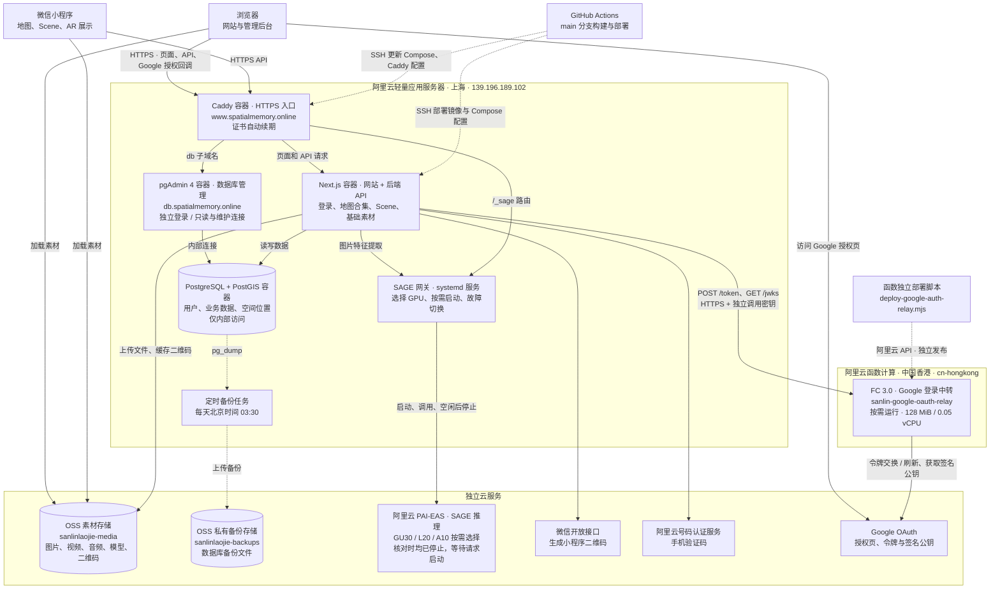

# 线上部署与服务说明

最后核对：**2026-10-19（北京时间）**。依据线上 Docker、systemd、端口、备份日志、PAI-EAS 服务状态，以及本仓库部署脚本整理；Web 与 Google 登录中转已核对至部署提交 `d855e8f`，其余服务运行状态沿用当天巡检快照。变更部署后应同步更新本文。

正式入口：**<https://www.spatialmemory.online/>**。整体由上海 Web 主机、OSS 文件存储、按需启动的 GPU 推理服务、中国香港 Google 登录中转函数，以及 Google、微信和短信接口组成。地图合集、Scene、基础素材属于同一个 Next.js 应用，共用同一个数据库。

## 部署关系图

实线表示业务访问，虚线表示部署或备份。



Google 授权页由用户浏览器直接访问，授权码随浏览器回调网站 `/api/auth/callback/google`。上海 Next.js 经香港函数交换令牌、获取 Google 公钥，再在上海完成验签、账号关联与会话创建；用户数据仍保存在上海 PostgreSQL，香港函数没有数据库访问权限。

## 服务用途与部署方式

Web 主机是阿里云**轻量应用服务器**，地域 `cn-shanghai`，部署目录 `/opt/sanlin`。Docker Compose 项目名为 `sanlin`，网络为 `sanlin_default`。

| 服务 | 用途 | 部署方式与位置 | 核对时状态 |
| --- | --- | --- | --- |
| Caddy | HTTPS、域名跳转、反向代理、证书自动续期 | Compose 的 `caddy`；容器 `sanlin-caddy-1`，镜像 `caddy:2-alpine`；挂载 `/opt/sanlin/Caddyfile`，证书保存在 `sanlin_caddy-data` 卷 | 运行中 |
| Next.js | Web 页面、管理 API、小程序 API、Better Auth 登录鉴权、上传与识别编排 | Compose 的 `app`；容器 `sanlin-app-1`，镜像 `sanlin-web:latest`；Node.js 22 + Next standalone，`linux/amd64` | 运行且健康 |
| PostgreSQL + PostGIS | 账号会话、团队、地图合集、素材、Scene、投放和空间查询 | Compose 的 `db`；容器 `sanlin-db-1`，镜像 `postgis/postgis:17-3.5`；数据库 `sanlin`，数据卷 `sanlin_db-data` | 运行且健康；唯一生产业务数据库 |
| pgAdmin 4 | 浏览表格、JSON、执行 SQL 和维护数据 | Compose 的 `pgadmin`；镜像 `dpage/pgadmin4:9.18`，独立配置卷 `sanlin_pgadmin-data`，512 MiB 内存上限；Caddy 提供 `db.spatialmemory.online` HTTPS | 2026-10-19 新增；登录与运维见 [pgAdmin 说明](pgadmin.md) |
| SAGE 网关 | 管理 GPU 生命周期、选择合格候选、预热校验和转发图片向量请求 | 主机 Python 虚拟环境 + `sage-fallback.service`，代码位于 `/opt/sanlin/sage-fallback`；独立于 Docker Compose | 运行中；控制器因空闲处于 `off` |
| SAGE 推理 | 将参考图、相机图片转为特征向量，供后端匹配；AR 渲染仍在手机端完成 | 阿里云 PAI-EAS 上海服务，GPU 由网关按需启动；详情见下节 | 所有候选 `Stopped`，运行实例数为 0 |
| OSS 素材桶 | 保存媒体、3D 模型、二维码和部分静态资源 | 上海桶 `sanlinlaojie-media`；应用经 OSS SDK 上传，客户端经公开 HTTPS 地址读取 | 已接入；使用 OSS 原始域名，未配置独立媒体 CDN |
| 数据库备份任务 | 导出生产数据库并上传到主机外的存储 | 主机 cron 执行 `/opt/sanlin/backup.sh`；`/etc/cron.d/sanlin-backup` 配置每天 03:30，服务器时区 `Asia/Shanghai` | 最近核对的 2026-10-19 定时备份成功 |
| OSS 备份桶 | 保存用于恢复的数据库 dump | 私有桶 `sanlinlaojie-backups`，对象前缀 `db/`；由备份脚本上传 | 已接入；不是运行中的数据库或热备副本 |
| 微信开放接口 | 获取 access token、生成合集和 Scene 的小程序码 | Next.js 服务端调用微信 API；生成图片按 `release/trial/develop` 分开缓存在 OSS，access token 缓存在应用进程内 | 已配置；二维码环境在 `/admin/settings` 浏览器端选择，默认 `release` |
| 阿里云号码认证服务 | 发送、校验手机号验证码 | Next.js 内的 `lib/auth/sms.ts` 调用 Dypnsapi；使用服务端 RAM 凭据，不额外部署短信进程 | 已接入；本次未发送真实短信测试 |
| Google 认证中转 | Google 令牌交换、刷新与签名公钥获取 | FC 3.0 中国香港 `cn-hongkong` 函数 `sanlin-google-oauth-relay`；Node.js 20、128 MiB、0.05 vCPU，按需运行；由 [独立脚本](../scripts/deploy-google-auth-relay.mjs) 发布，配置见 [中转说明](google-auth-relay.md) | 已上线；生产容器获取公钥、无效授权码回调与中转鉴权检查通过，真实账号授权仍需用户验证 |
| 微信小程序 | 扫码入口、地图内容与 Scene 播放、手机端 AR | 兄弟项目 `xr-frame-plant-trees` 通过微信开发者工具独立编译、上传和发布；通过 `/api/miniapp/*` 访问 Web 后端 | 配套 Scene / 新内容模型版本仍待用户另行发布 |
| GitHub Actions | 质量检查、镜像构建、Web 部署和冒烟检查 | [Deploy 工作流](../.github/workflows/deploy.yml)，push `main` 或手动触发 | 已启用；不发布小程序、SAGE 或香港 FC 函数 |

SMTP 邮件发送是可选功能，核对时未配置 `SMTP_HOST` / `SMTP_FROM`。Better Auth 运行在 Next.js 内，没有单独的认证容器。当前主链路不通过 Vercel 或 Supabase；历史迁移记录不代表仍在使用那些服务。

## 域名、端口与请求路径

`www.spatialmemory.online` 和 `spatialmemory.online` 的 DNS A 记录都指向 `139.196.189.102`。HTTP 跳转 HTTPS；裸域名再跳转到 `www`，保留路径与查询参数。原 IP 的 HTTPS 入口仍保留，供客户端域名切换过渡使用。

`db.spatialmemory.online` 同样指向此主机，由 Caddy 独立路由到 pgAdmin，不经过网站的登录系统。

| 入口 | 可达范围 | 作用 |
| --- | --- | --- |
| TCP 80、TCP/UDP 443 | 公网 → Caddy | HTTP 跳转、HTTPS / HTTP/3 |
| TCP 22 | 运维与 CI → 主机 SSH | 部署、只读检查、数据库隧道 |
| `app:3000` | Docker 内部网络 | Caddy 转发到 Next.js；未映射为主机公网端口 |
| `pgadmin:80` | Docker 内部网络 | Caddy 转发到数据库管理页面；未映射主机端口 |
| `db:5432` / `127.0.0.1:5432` | 应用容器 / 主机回环 | 应用数据库访问；外部运维通过 SSH 隧道进入 |
| `172.18.0.1:18080` | 主机 Docker 网桥 | SAGE 网关；应用的 `SAGE_EAS_ENDPOINT` 指向此地址 |
| `/_sage/*` | 经 Caddy 的 HTTPS 入口 | 去掉前缀后转发至网关；`/health`、`/embed`、`/status` 仍需网关 Token |
| `sanlin-th-relay-vchqmnnrvk.cn-hongkong.fcapp.run` | 公网 HTTPS 入口，函数校验独立调用密钥 | 香港 Google 中转，仅支持 `POST /token` 和 `GET /jwks`；调用密钥只在服务端配置 |

典型请求路径：

- 管理与扫码：客户端 → Caddy → Next.js → PostgreSQL。素材和 Scene 保存即生效，引用通过 ID 读取当前内容。
- 文件：浏览器上传 → Next.js `/api/upload` → OSS；浏览器和小程序按媒体 URL 加载文件，网页部分图片也经过 Next.js 图片优化接口。
- 识别：小程序 → Next.js 识别接口 → SAGE 网关 → PAI-EAS 返回向量 → 后端匹配并返回结果。
- Google 登录：浏览器访问 Google 授权页 → 浏览器回调 Caddy / Next.js → 香港 FC → Google 令牌与公钥接口 → Next.js 验签并在 PostgreSQL 中创建或关联账号、保存会话。

## SAGE 独立部署与运行策略

网关与模型源码位于兄弟项目 `ai-location`，主要说明在 `ai-location/deploy/sage/fallback/README.md`。**Web 的 GitHub Actions 和 `npm run deploy` 不会更新这两项服务。**

- 网关：Python 程序、虚拟环境和依赖部署到 `/opt/sanlin/sage-fallback`，由 systemd 管理；私有配置与云凭据在 `/etc/sage-fallback/`，恢复状态在 `/var/lib/sage-fallback/state.json`。更新后通过 systemd 重启并核对状态。
- 模型：通过 `ai-location/deploy/sage/` 的部署工具与阿里云 PAI-EAS 管理接口更新。模型、容器、规格或挂载变化需重新验证候选资格并更新网关注册表，不能只更新某个推理服务就视为全部发布完成。
- 正式候选按顺序尝试：GU30 32 核 `sage_qual_gu30_32_1014` → L20 `sage_qual_l20_1014` → A10 `sage_anchor_gpu`。名字含 `qual` 的前两项已用于正式调度。
- 两个未通过资格验证的服务 `sage_qual_gu30_1014`（8 核）、`sage_qual_gu30_16_1014`（16 核）保持停止，不参与自动启动。
- 顺序启动与回退，确认旧实例释放后才启动下一个；有需求时启动，空闲 1800 秒后释放。首次请求可能经历冷启动或缺货等待，不代表模型随时已就绪。
- `/readyz` 仅检查网关存活；带 Token 的 `/status` 只读状态。**`/health` 和 `/embed` 会登记需求，不能用作保持空闲时的定时巡检。**

## Web 发布方式

日常自动部署以 [Deploy](../.github/workflows/deploy.yml) 和 [质量检查](../.github/workflows/ui-quality.yml) 为准：

1. push `main` 或手动运行工作流，先完成 typecheck、lint、生产构建和隔离 PostGIS 迁移回归。
2. 构建 `linux/amd64` 的 `sanlin-web:<commit SHA>` 镜像。`NEXT_PUBLIC_*` 在构建时写入前端包，修改这类配置需要重新构建。
3. 经 SSH 对目标数据库运行只读部署门禁，核对迁移账本和实际结构；缺迁移或残留旧结构时阻止部署。
4. 使用 `docker save | gzip` 经 SSH 传输镜像，再在服务器 `docker load`；当前链路不使用镜像仓库。复制 Compose、Caddy 和备份脚本，保留服务器 `/opt/sanlin/.env`。
5. 将目标镜像标为 `sanlin-web:latest`，执行 Compose 更新、Caddy reload，最后访问首页做 HTTP 200 冒烟检查。

手工发布入口是 [`scripts/deploy.sh`](../scripts/deploy.sh)（`npm run deploy`）：本地构建后走相同的 SSH 传输方式，并安装备份 cron。与 CI 不同，**手工脚本会用所选环境文件覆盖服务器 `.env`**；应先核对该文件，避免覆盖现有域名、SAGE 或凭据配置。

部署配置索引：[`Dockerfile`](../Dockerfile)、[`docker-compose.yml`](../deploy/docker-compose.yml)、[`Caddyfile`](../deploy/Caddyfile)、[`env.example`](../deploy/env.example)。密钥、服务器 `.env`、SAGE 私有注册表和数据库 dump 均不提交 Git。

pgAdmin 的首次 secret 和数据库角色需按 [部署说明](pgadmin.md) 初始化；后续 Web 部署同步其公开配置与镜像，保留账号配置卷和私有凭据。

### 登录配置与 Google 网络依赖

新用户通过 Google 或中国大陆手机号注册，存量邮箱保留密码登录；密码重置仅支持手机号验证码。此改动不需要数据库迁移，认证回归由 `scripts/test-sms-auth.cjs` 纳入 CI。

Google 的 `GOOGLE_CLIENT_ID`、`GOOGLE_CLIENT_SECRET` 保存于服务器 `/opt/sanlin/.env`，回调地址为 `https://www.spatialmemory.online/api/auth/callback/google`。生产凭据已于 2026-10-19 配置，重建应用容器后生效；凭据不进入仓库或镜像。

上海主机无法直连 Google，因此服务端请求通过中国香港 FC 中转。`GOOGLE_RELAY_URL` 和 `GOOGLE_RELAY_SECRET` 保存在 `/opt/sanlin/.env`，网站仍负责 OAuth state、PKCE、Google JWT 验签、账号关联与会话。香港函数没有数据库访问权限。用户浏览器仍须能打开 Google 授权页；真实账号授权与自动化测试的验证范围见 [中转说明](google-auth-relay.md)。

## 数据库迁移、备份与恢复边界

生产数据库已在 2026-10-19 完成团队内容模型迁移。后续改表仍需遵循以下顺序，部署脚本不会自动执行迁移：

1. 获取目标库完整备份，在隔离副本验证迁移及数据保留；需要破坏性升级时安排停写，并在停写后获取最新备份。
2. 经 [`scripts/db-tunnel.sh`](../scripts/db-tunnel.sh) 连接目标库，按 [迁移手册](content-model-migration-runbook.md) 执行 `npm run db:migrate`，核对迁移账本、引用和归档。
3. 运行只读部署门禁，再发布匹配结构的 Web；涉及客户端协议变化时协调小程序独立发布和验收。

[`deploy/backup.sh`](../deploy/backup.sh) 使用 PostgreSQL custom 格式压缩导出，保存为 `/opt/sanlin/backups/sanlin-<时间>.dump`，随后上传到私有 OSS 的 `db/` 前缀；本地通过 `find -mtime +3` 清理旧 dump。OSS 保留周期由桶生命周期配置管理，本文不将历史文档中的周期当作已重新核验值。

这些 dump 备份数据库内容，不包含 OSS 媒体文件、服务器配置或 SAGE 凭据。数据库文件与 Caddy 证书使用持久卷；替换应用容器不会清空它们。恢复时需匹配数据库结构与应用版本，删表删列之后不能只回滚旧应用镜像；详见迁移手册。

目前 Web 与数据库共用一台主机，没有自动接管的备用主机或数据库副本。OSS 备份用于恢复，不能替代高可用。

## 只读巡检与文档维护

以下命令不会迁移数据库或唤醒 GPU：

```bash
ssh root@139.196.189.102 'cd /opt/sanlin && docker compose ps'
ssh root@139.196.189.102 'systemctl status sage-fallback --no-pager'
ssh root@139.196.189.102 'curl --fail --silent --show-error http://172.18.0.1:18080/readyz'
ssh root@139.196.189.102 'tail -n 10 /var/log/sanlin-backup.log'
curl --head https://www.spatialmemory.online/
```

`/readyz` 成功只表示网关存活，不表示 GPU 已启动；首页成功也不覆盖短信、识别或手机 AR 全链路。更新域名、端口、Compose、GPU 候选、备份策略或小程序发布状态时，同时更新本文的核对日期与对应条目。

服务职责以本文和部署配置为准；数据库升级与恢复统一查阅 [迁移手册](content-model-migration-runbook.md)。上文运行状态仅代表文首标注的核对日期。
