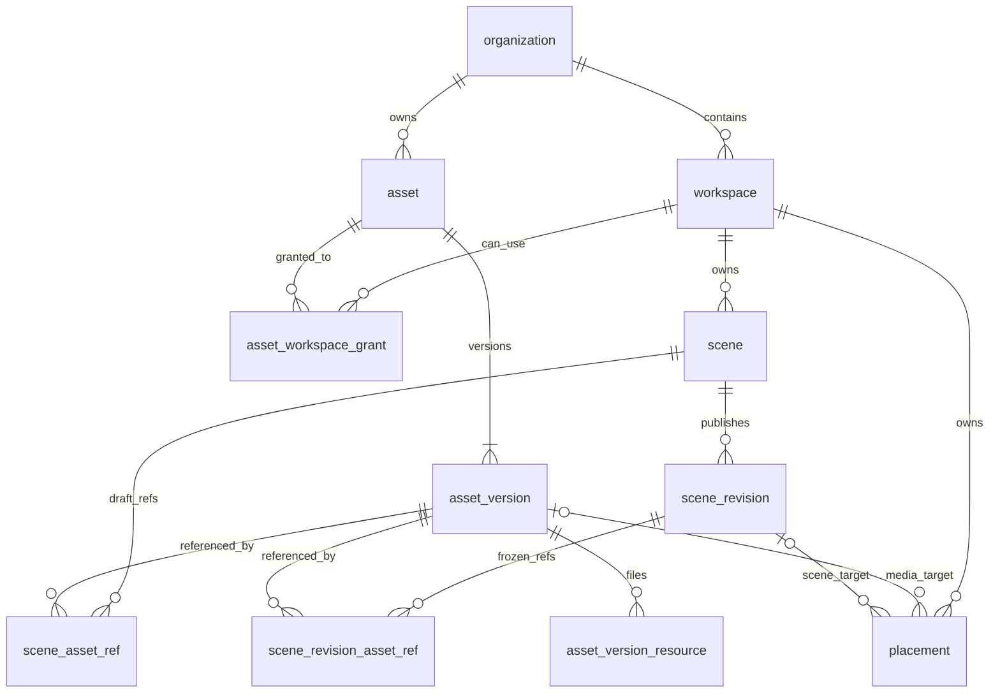

# 团队素材复用与场景管理改造方案

日期：2026-10-15。状态：首期代码已实现并完成隔离环境验证；尚未执行生产迁移。首期目标是团队协作、跨项目素材复用和可控更新；种树等活动只预留业务接入边界。实现结果与验证范围见 [实施与验证记录](content-model-validation.md)，上线操作见 [迁移手册](content-model-migration-runbook.md)。

组织管理所有权，Workspace 作为项目，Asset 管理可复用素材，Scene 管理作品编排，Placement 管理一次空间投放。首期保留现有 Three 场景编辑器、Theatre 时间轴、Cesium 地图和小程序播放协议，主要调整数据、权限、入口和生命周期。

本方案的首个完整验收流程是：A 在项目甲上传并共享模型，B 在项目乙引用同一素材版本；A 上传新版后，两人的作品与线上体验保持原样；B 预览并主动升级自己的场景；任一素材的维护者能够查看依赖，删除和撤销授权不会使作品突然失效。

## 1 已确定的产品决策

1. **Organization 是租户与所有权边界。** 每个新素材只有一个所属组织。`created_by`、OSS 路径和项目列表均不能代替所有权。
2. **Workspace 对外统一称为项目。** 保留现有表名、UUID、组织关系和二维码参数，首期不再新增 Project 层。
3. **使用权与维护权分开。** 项目可以引用素材，只有素材维护者和组织管理员可以修改源素材。首期每个素材设置一名维护者，管理员可转交维护责任。
4. **所有引用固定到版本。** 素材新版本不会自动修改草稿、发布版本或单素材投放。升级由使用方发起。
5. **Scene 成为独立作品。** 场景对象仍保存在编排 JSON 中，继续复用现有实例、时间轴与动画实现；反向依赖由服务端派生。
6. **位置属于 Placement。** 单素材可以直接投放，用户上传照片或文字时无需创建 Scene。素材的采集 GPS 与投放坐标分开。
7. **活动内容拥有独立生命周期。** 未来 Topic、Reply、种子账目不写入素材或场景 JSON；首期不创建活动业务表，不开发通用规则引擎。

Kivicube 可借鉴的是素材库与对象引用的区分、使用中素材的删除保护，以及局部替换与共享素材更新的操作区分。素材版本固定和独立发布快照是本方案的设计选择，不能视为已核实的 Kivicube 内部实现。官方依据见第 12 节。

## 2 改造前代码基线与问题

以下描述保留方案制定时的源码基线，代码入口及行号用于解释改造原因，不代表当前实现。当前模型见第 4 节及各专题文档。实际存量记录、残留实验表与线上客户端分布，仍需在生产迁移预检中确认。

| 当前事实 | 代码入口 | 对改造的影响 |
| --- | --- | --- |
| `asset` 同时保存文件、文字、位置、Anchor、配置和 `workspace_id uuid[]` | `db/schema.sql:164` | 拆分素材身份、固定版本与投放；处理跨组织历史记录 |
| Scene 是 `asset.file_type='scene'`，JSON 在 `text_content` | `docs/scene-asset.md:3` | 迁为独立 Scene；旧 ID 由兼容层处理 |
| 模型必须在场景每个 Workspace 中，运行时读取当前 URL | `lib/scene/asset.server.ts:16` | 改为同组织授权校验和明确版本引用 |
| `scene_revision` 是 MD5 编辑指纹 | `lib/scene/asset.server.ts:7` | 与真正的发布版本区分；新接口强制提交 `expectedLockVersion` |
| `workspace_assignment.role` 未实际决定权限 | `lib/permissions.ts`、`lib/permissions.server.ts`、`db/schema.sql:409` | 明确项目 manager/editor/viewer，并迁移现有 assignment |
| 项目和组织素材 GET 仅检查登录；上传尚未检查项目编辑权 | `app/api/workspaces/[id]/assets/route.ts:15`、`app/api/organizations/[id]/assets/route.ts:7`、`app/api/upload/route.ts:104` | 首批补齐服务端授权；所有新旧入口调用同一策略 |
| 地图选择、移动、复制均使用 Asset ID | `app/manage/store.ts`、`app/manage/hooks/useViewerMessaging.ts`、`app/api/assets/{move,copy}/route.ts` | 地图改用 Placement ID，源素材 ID 独立保存 |
| 场景编辑器从 Asset API 读写 | `app/manage/scenes/components/useSceneDocument.ts` | 替换数据适配，保留编辑器主体 |
| 文件回收主要统计当前 Asset 文件与 Shop 打卡图 | `lib/storage-cleanup.server.ts`、`app/api/admin/clean/route.ts`、`lib/user-deletion.server.ts` | 写入第一个历史版本前，先保护版本文件与上传中的文件 |
| Anchor 和 embedding 依赖现有 Asset ID | `db/schema.sql`、`lib/anchor/` | 首期保留识别实现与稳定 ID，通过适配器隔离 |
| 小程序严格要求发现记录 ID 等于 Scene manifest.assetId | `../xr-frame-plant-trees/miniprogram/components/xr-start/assets/scene.js:17` | 新数据库文档不能直接作为旧播放协议返回 |
| Shop ID 用于本地打卡记录，匿名文字有独立旧写入口 | `../xr-frame-plant-trees/miniprogram/components/shop-checkin/index.js:180`、`app/api/miniapp/text-assets/route.ts` | 两者必须纳入迁移，不能只改场景与附近接口 |

`PRODUCT.md` 和 `docs/scene-asset.md` 已同步为新模型及 legacy 兼容约定。组织未切换前仍使用旧写源。`scene-refactor-backup-20261011/` 只作历史参考，不直接恢复代码或 SQL。

## 3 首期范围与交付边界

| 首期交付 | 后续按需求实施 |
| --- | --- |
| 项目角色与统一服务端授权 | 实时多人协同编辑、审批工作流 |
| 项目素材、组织共享素材、场景使用中三个视图 | 跨组织素材市场、复杂许可证与用户级 ACL |
| 单维护者、版本历史、使用记录、主动升级 | 多维护者细粒度授权、自动批量升级策略 |
| 独立 Scene、草稿并发保护、固定发布版本 | 嵌套场景、Prefab、模板市场、跨场景行为图 |
| Placement 最小拆分、单素材一键投放 | 多渠道发布流水线、排期、实验分流、合辑 |
| 当前模型编排能力与旧客户端兼容 | 图片、音视频等新增场景节点能力 |
| 活动类型、内容引用、表现适配的接口约定 | Topic、Reply、奖励、区域治理等活动实现 |

素材版本、发布快照和 Placement 的最小拆分共同保证“更新共享素材不会改变别人的线上内容”，属于首期基础。首期不增加独立 Release 管理平台，也不强迫普通图片、文字包装为单节点 Scene。

## 4 目标数据模型



Placement 两种目标互斥。Scene Object 继续作为 JSON 内对象，不为每个节点、关键帧建立数据库行。除下列实体外，迁移映射和上传回执属于内部支持数据，不出现在用户导航中。

### 4.1 素材身份与项目授权

| 表 | 字段与约束 | 语义 |
| --- | --- | --- |
| `organization` | 沿用现有 ID、成员与配置 | 所有权和租户边界 |
| `workspace` | 沿用 `organization_id`；增加归档状态 | 项目，不代表现实地点 |
| `workspace_assignment` | `(workspace_id,user_id)` 唯一；`role` 收口为 manager/editor/viewer | 项目协作角色，受组织角色上限约束 |
| `asset` | 增加 `organization_id`、`origin_workspace_id?`、`maintained_by?`、`visibility`、`state`、`current_version_id`、`lock_version`、`origin` | 素材身份与目录信息，保留现有 `id/name/file_type/created_by` |
| `asset_workspace_grant` | `asset_id,workspace_id,organization_id,created_by,created_at`；主键为 `(asset_id,workspace_id)` | 同组织项目的稳定使用授权，首期只有 use 一种权限 |

具体取值与边界：

- `visibility = restricted | organization`。前者只向维护者、管理员及获授权项目开放；后者允许同组织成员浏览，项目编辑者可选用。
- `origin_workspace_id` 只记录来源。普通上传自动给来源项目建立 grant；授权必须读取 grant，不能从来源字段推导。历史来源不明时允许为空。
- `state = active | archived`。归档后从新增素材选择器隐藏，现有引用仍可解析与播放。
- `maintained_by` 必须是有效组织成员；首次上传默认为上传者。维护者离职后置空，由 owner/admin 接管，素材和版本继续存在。
- `origin = team_upload | public_submission | legacy`。当前匿名文字保持 `public_submission`，进入投放与管理视图，不自动进入组织共享目录。
- `file_type` 首期继续使用现有媒体类型。新 Scene 走独立表；旧 `anchor/shop` 行仅供专用兼容服务使用，不出现在通用模型选择器中。

三个素材视图共用一份身份数据：

| 视图 | 查询依据 |
| --- | --- |
| 本场景使用中 | `scene_asset_ref`，展示实际引用的固定版本 |
| 项目素材 | `asset_workspace_grant`，显示版本、来源和使用情况 |
| 组织共享素材 | 当前组织且 `visibility=organization`，按权限过滤 |

任何把素材引入目标项目的命令，包括场景添加、直接素材投放、素材投放复制和另存素材副本，都要在事务中确认同组织及使用权，并建立或检查 grant。把素材从组织共享改为 restricted，只停止新的自由选用；已有 grant 保留并在界面列出。撤销具体项目 grant 时检查草稿、保留的发布版本和直接投放引用，有依赖则返回 409 和影响清单。授权变更与新增引用使用同一组锁，提交前复核授权，避免撤权与保存并发穿过检查。

已发布 Scene 的整体投放复用不等于直接使用其中每个源素材，按 4.4 节执行；复制为可编辑 Scene 时才逐项取得素材 grant。首期保留所有发布版本，因此归档通常不能释放授权依赖；有历史发布引用的 grant 需要保留，直到后续管理员清理保留版本能力落地。

首期“从项目移除”明确表示撤销该项目的使用授权，不混入收藏夹语义。素材库分页或搜索过滤不会改变已引用资源的可解析性。

### 4.2 素材版本与物理文件

| 表 | 字段与约束 | 语义 |
| --- | --- | --- |
| `asset_version` | `id,asset_id,version_no,payload_schema_version,payload,created_by,created_at`；`UNIQUE(asset_id,version_no)` | 已完成处理的不可变内容版本 |
| `asset_version_resource` | `asset_version_id,role,ordinal,storage_key?,external_url?,content_hash?,mime_type?,size_bytes?`；主键 `(asset_version_id,role,ordinal)` | 该版本实际保留的文件清单 |

`payload` 按素材类型校验：文字正文、链接目标、文件固有尺寸、动画列表及素材默认参数均属于版本。`storage_key` 与 `external_url` 恰有一个；本站 OSS URL 入库时必须规范化为 key，不能作为 external_url 绕过引用保留。主文件、封面、打卡图、音频兼容文件等全部以明确 role 登记，payload 不得暗藏受管理文件地址。首期不另建 Blob 去重平台，多个资源行可以引用同一物理 key。

新上传的媒体使用不可覆盖的受管文件。历史外站文件可先保留 external_url，清单明确标注为外部资源：只能固定地址，无法保证远端字节不变，也不进入 OSS 删除流程。链接素材同样只固定链接文本与目标；需要可复现的媒体内容时，先导入受管存储再建立新版本。

文件地址由 resource 清单解析，避免在 payload、当前素材和资源表中维护多个可编辑 URL。`asset.file_url/text_content/metadata/config/content_hash` 在迁移期作为旧模型数据或只读投影保留；新业务只读版本内容。原始采集 GPS 可保留为来源元数据，不能触发投放。

新版本在文件上传、必要处理及校验完成后一次提交；状态未完成的上传不是可引用版本。创建版本锁定 Asset 行、分配序号并推进 `current_version_id`。业务身份不同但字节相同的素材允许共享底层文件，不能因 hash 相同而自动合并 Asset 身份。

### 4.3 场景草稿与发布版本

| 表 | 字段与约束 | 语义 |
| --- | --- | --- |
| `scene` | `id,organization_id,workspace_id,name,draft_document,lock_version,state,created_by,updated_by,updated_at` | 一个项目拥有的一份作品；state 为 active/archived |
| `scene_asset_ref` | `scene_id,resource_alias,asset_version_id`；主键 `(scene_id,resource_alias)` | 草稿引用索引，由文档派生 |
| `scene_revision` | `id,scene_id,revision_no,source_lock_version,name,document,created_by,created_at`；`UNIQUE(scene_id,revision_no)` | 发布时的不可变快照 |
| `scene_revision_asset_ref` | `scene_revision_id,resource_alias,asset_version_id`；主键 `(scene_revision_id,resource_alias)` | 发布依赖索引，由快照派生 |

新的管理端文档可升为内部 schemaVersion 3，保留现有 composition、instances、tracks，只将资源引用扩为明确版本，例如：

```json
{
  "schemaVersion": 3,
  "content": {
    "kind": "composition",
    "units": "meters",
    "durationSeconds": 10,
    "loop": true,
    "assets": {
      "dragon": {
        "assetId": "asset-uuid",
        "assetVersionId": "version-uuid"
      }
    },
    "instances": []
  }
}
```

示例 ID 是占位符，实际必须通过 UUID、版本归属、同组织与授权校验。`assetId` 用于身份和升级 UI，`assetVersionId` 决定内容。未知字段仍拒绝；8 个资源别名、24 个实例等当前能力限制首期保留。新建使用服务器 v3 空白工厂，沿用 10 秒、loop=false、空 assets/instances 的默认值，不把上述引用示例当成默认文档。

草稿 JSON 是编排事实源，两个引用表是服务端生成的索引，不能通过独立 API 修改。保存事务必须包含权限检查、版本归属与可用性校验、按 `lock_version` 条件更新、重建依赖索引。缺少预期版本返回 428，过期返回 409；兼容写入口也不能绕过锁。

发布事务锁定指定草稿版本，验证依赖、动画配置及文件状态，生成快照和发布依赖。不重新读取素材 current 版本。空场景可保存，但不能创建新的有效投放。归档素材允许原有相同引用继续保存和重新发布；新增引用、替换为已归档素材被拒绝。

场景列表展示“未发布 / 已发布 / 有未发布修改 / 已归档”；前面三个状态由草稿 lock 和发布记录计算，不另存一组可能失真的状态字段。首期没有任意删除历史版本的用户入口。

### 4.4 投放与现有定位能力

`placement` 最小字段：

| 字段 | 用途 |
| --- | --- |
| `id,organization_id,workspace_id,name` | 单一归属的投放身份；地图以此 ID 选中和操作 |
| `asset_version_id? / scene_revision_id?` | 恰有一个，禁止指向可变 current 或草稿 |
| `location?,anchor_id?` | GPS 发现位置和识别目标；保留现有同时配置两者的行为 |
| `render_config` | 投放比例、朝向、文字样式、巨大模型等局部覆盖，按类型校验 |
| `status` | draft / active / paused / archived |
| `lock_version,created_by,updated_by,created_at,updated_at` | 并发保存与审计信息 |

`location` 规范为 WGS84 的 Point；历史无 SRID 几何先检查来源，再正确设置 SRID，不能未经判断调用坐标转换。高度保留为明确字段或受校验的 render_config，不再重复维护两份经纬度。

首期有效空间投放必须具备当前运行时支持的 GPS 或 Anchor 发现路径。现有 Shop 有一个明确兼容例外：无坐标店铺仍可创建目录型 Placement，由 shops 接口返回，不进入 GPS/Anchor 发现，位置相关操作保持现有限制。现有 Scene 在小程序中实际放于相机前方，Placement 先控制发现和版本选择，不承诺升级成精确地理位姿渲染。Anchor 的数据、`anchor_embedding`、SAGE 接入保持现有实现；`placement.anchor_id` 暂时外键指向 `asset` 中的 anchor 行，服务层校验类型、组织和可用范围。

新投放的 `id` 与源素材 ID 分离，同一个素材可产生多个投放。对 Scene 的发布只创建版本，投放升级需明确选择目标；可以提供“发布并更新当前投放”的组合动作，并显示实际影响范围。

同组织跨项目首次使用已发布 Scene，或切换到新的来源 Revision 时，操作者须有来源项目的发布权和目标项目的编辑权。移动、暂停、归档既有投放只检查目标项目权限。目标项目使用的是固定的已发布作品，不因此获得源草稿和私有素材目录的读写权限，也不要求逐项取得源素材 grant；复制为可编辑 Scene 时才需要这些 grant。首期主要用于已有多项目展示的兼容，不增加跨项目场景商城。

项目标签继续复用现有 `tag`。新投放关联通过 `placement_tag(placement_id,tag_id,workspace_id)` 保证同项目；首期素材库主要按名称、类型、来源与状态筛选，不另建组织标签体系。多项目旧记录的标签按旧项目保存在兼容映射中，不能静默丢弃。

### 4.5 关系约束与操作审计

- 所有资源、项目、场景、投放的组织归属使用复合外键或事务内受锁保护的校验；不能用跨行 CHECK 假装已保证组织一致。
- `asset.current_version_id` 必须属于自身；Scene 引用版本必须属于文档中的 Asset；Placement 的两种目标使用 XOR CHECK。
- 草稿、发布依赖和投放对版本使用 `ON DELETE RESTRICT`。归档不会删除关系。删除项目或组织先生成完整删除计划，禁止直接级联吞掉共享依赖。
- 资源版本不可变通过服务权限和数据库更新限制实现。以后增加硬删除，也只能由检查引用的维护命令执行。
- 增加一张 `content_audit_log` 记录共享、撤权、维护者转交、归档、发布、投放切换和迁移操作，含 actor、组织、对象 ID、操作类型及必要变更字段。版本内容仍存在版本表；不引入事件溯源系统。

## 5 团队权限与生命周期

### 5.1 权限计算

保留组织 owner/admin/member/viewer。owner/admin 隐式具有本组织全部项目的 manager 权限；member 按项目 assignment 获权；组织 viewer 是只读上限，即使错误存在 editor assignment 也不得写入。

启用新权限前，M0 生成用户与项目的授权映射，M1 按下表回填并同时更新所有建成员入口：

| 现有身份 | 迁移规则 |
| --- | --- |
| org owner/admin | 组织内全部项目隐式 manager，无需批量造 assignment |
| org member 且有有效 assignment | 赋 editor；不直接信任旧惰性 role 文本的权限含义 |
| org viewer 且有有效 assignment | 赋 viewer |
| org member/viewer 无 assignment | 不自动获得项目权限；实际应授权但漏建关系的项目由管理员在预检映射中补齐，不能把宽松 API 的可访问范围当作合法授权 |
| 非组织成员的 assignment 或异常角色 | 隔离并核对，不自动提权 |

同步修改 `workspace_assignment.role` 默认值与 CHECK、邀请接受、成员分配、批量注册等写入者。新项目授权默认为 editor，组织 viewer 强制收口为 viewer；新注册的个人组织 owner 使用隐式 manager。项目 manager 的操作走新的项目范围成员 API，不能直接复用当前仅允许组织管理员调用的 `/api/users/[id]/workspaces`。

| 操作 | 授权条件 |
| --- | --- |
| 浏览项目、项目素材与场景 | 组织成员且可访问项目；管理员隐式可访问 |
| 在项目上传、建场景、编排、发布、管理投放 | 项目 editor/manager，且组织角色允许写入 |
| 使用组织共享素材 | 同组织，可浏览；选入项目还需该项目编辑权 |
| 使用 restricted 素材 | 目标项目有 grant；选择或保存动作还需项目编辑权 |
| 更新源文件、名称、版本、共享范围、归档 | 素材 maintained_by 或 owner/admin，且组织角色允许写入 |
| 把 restricted 素材授权给项目 | 有素材维护权，且可访问目标项目；目标必须同组织 |
| 转交素材维护者 | owner/admin；新维护者为有效可写组织成员 |
| 管理项目成员 | owner/admin 或项目 manager；manager 只能在既有组织成员中分配 editor/viewer，不能提升组织角色或授予其他 manager |
| 查看反向依赖 | 可读素材；仅展示调用者有权查看的场景名称，其余显示受限使用计数 |

服务层提供 `requireWorkspaceRead/Edit/Manage`、`requireAssetRead/Use/Maintain`、`requireScenePublish` 等有限 helper，列表、详情、版本、上传、按 hash 查询、复制、批量动作全部复用。UI 只负责呈现这些能力，不作为鉴权边界。

当前 OSS 使用公开 URL。“项目可见范围”首期指目录和 API 授权，不等同文件字节保密。公开体验只通过 active Placement 返回受控运行清单，不能读取素材目录或草稿；若以后需要机密素材，单独增加鉴权分发能力。

### 5.2 操作效果

| 操作 | 数据变化 | 对已发布内容的影响 |
| --- | --- | --- |
| 上传素材 | Asset + v1 + 来源项目 grant | 不自动投放 |
| 上传并放置 | 上述记录 + 指向 v1 的 active Placement | 立即新增一个明确投放 |
| 新增素材版本 | 新 Version，推进 current 指针 | 全部旧引用保持原版本 |
| 升级场景素材 | 更改选定资源别名的版本，校验 clip，保存草稿 | 发布和投放保持原样 |
| 复制对象 | 复制实例配置，引用同一版本 | 仅修改当前草稿 |
| 复制场景 | 新 Scene，复制文档，继续引用固定版本 | 原作品保留；跨项目需检查或取得全部素材 grant |
| 另存素材副本 | 新 Asset + 独立版本序列，可共享物理文件 | 原素材保留 |
| 另处投放 | 新 Placement，引用同一固定内容 | 与原投放独立移动、暂停和升级 |
| 删除对象或移除投放 | 删除草稿节点，或归档 Placement | 不删除素材 |
| 归档素材 | 标记 archived | 原引用继续工作，新使用被禁止 |
| 撤销项目授权 | 无依赖时删除 grant；有依赖返回 409 | 不静默破坏草稿或发布 |
| 回滚投放 | 切换到仍保留、经过校验的旧版本 | 下一次加载使用选定版本，已在播会话按现有重载机制更新 |

升级界面要明确“本实例 / 本场景所有引用该别名的实例”。若只升级一个实例，创建新的资源别名，避免隐式修改共享别名的其他对象。旧动画 clip 不存在时阻止提交，保留草稿供用户调整。

首期项目删除默认归档。需要硬删除项目、用户或组织时扩展现有 deletion plan，列出跨项目发布投放、版本文件和旧兼容行；带依赖的源项目不得绕过保护。用户退出或删除只影响身份和维护责任，不能根据 OSS 路径删除团队文件。

归档效果固定如下，界面在确认时列出受影响的投放与旧入口：

| 归档对象 | 已有展示 | 后续写入和新使用 |
| --- | --- | --- |
| Asset | 直接投放和已发布 Scene 均继续使用已固定版本 | 禁止新的直接素材引用和复制为新草稿的引用；已有草稿相同引用可保存、发布；已发布 Scene 的整体复用允许继续 |
| Scene | 已有 Placement 继续播放保留版本 | 禁止编辑、新发布和新建投放，需先恢复 Scene；投放仍可暂停或归档 |
| Workspace | 自有 Placement 在所有入口停止展示；仅删除该项目的 legacy 可见 scope 不影响其他有效入口；其他活动项目已引用的 SceneRevision 继续保留播放 | 项目内容只读，禁止新授权、创作、发布和投放；管理员可恢复 |

组织归档停止该组织全部入口与写入。归档不删除版本或文件，不释放历史依赖；项目归档时，来源于它的 canonical Placement 即使另有 legacy scope 也停止展示，其他项目独立拥有的投放不受此规则影响。

## 6 页面结构与现有组件复用

组织和项目选择器继续复用。显式 URL 上下文优先于 persisted store；`__all__` 仍只表示聚合浏览。新建场景、投放和项目上传必须选择真实项目；组织共享目录使用明确的组织上下文。

```text
组织选择器
├── 素材库                 /manage/assets
│   ├── 项目素材
│   └── 组织共享
├── 场景                   /manage/scenes
├── 投放地图               /manage
├── 现场上传               /upload-onsite
└── 项目与成员管理          /admin/workspaces 和 /admin/members
```

| 页面 | 首期结构 | 复用与修改 |
| --- | --- | --- |
| 素材库 `/manage/assets` | 搜索、类型/来源/状态筛选、上传；卡片显示维护者、当前版本、使用数量 | 复用 Thumbnail、Preview、上传字段；AssetCard 先改为 props 驱动，解除地图 store 耦合 |
| 素材详情 `/manage/assets/[id]` | 基本信息、版本、使用记录、共享范围；上传新版本和转交维护者 | 素材属性保留；移走位置、Anchor 与地图复制操作 |
| 场景列表 `/manage/scenes` | 当前项目作品；新建、复制、编辑、发布状态、投放数量 | 创建 Scene 从上传面板迁到独立入口；JSON 导入为辅助动作 |
| 场景编辑 `/manage/scenes/[id]` | 标题和项目、保存状态、预览、发布；素材选择器有三种视图 | 保留 SceneViewport、Timeline、Inspector、Theatre、dock；改 useSceneDocument 和资源解析 |
| 投放地图 `/manage` | 三栏布局；列表是 Placement，右侧编辑位置、定位目标、版本和状态 | 保留 ViewerFrame、Cesium；重组 AssetEditorPlacementSection；按投放 ID 操作 |
| 现场上传 `/upload-onsite` | 拍照/录音/文字，确认位置后一步完成投放 | 复用预处理和表单，改用服务器组合命令 |
| 项目与成员管理 | 项目归档、角色和已有邀请流程 | 复用 ManageWorkspaceDialog 等现有组件，明确项目角色 |

具体交互约束：

- 场景素材选择器内提供“选择已有素材”和“上传并添加”，不要求先离开编辑页。
- “已引用资源”与“当前可选素材列表”分开请求，避免分页、归档或过滤使现有模型从视口消失。
- 已解析资源按 `resource_alias/assetVersionId` 索引，缓存也必须区分版本。同一 Asset 的 v1/v2 可以同时出现在一个场景，不能继续按 assetId 合并别名或寻找 URL。需同步修改 `SceneEditor.tsx`、`SceneViewport.tsx`、`useSceneDocument.ts` 和 ModelAsset 类型；去掉 commit 强制写 schemaVersion 2 的逻辑，保留 Theatre 对实例和 tracks 的适配。
- 素材详情显示哪个项目的哪个场景引用了哪个版本；已发布使用和草稿使用分开展示。
- 场景保存失败或版本冲突时保留本地草稿，提供重新载入/复制内容，不自动覆盖服务器。
- 组织全项目地图可浏览，但创建和复制投放需选择目标项目。旧共享投放显示来源项目，在非来源项目只读。
- 识别目标与 Shop 首期保留专用管理面板，普通素材卡片不再混入这两类业务对象。

地图适配暂时可以保留 `SET_ASSETS / ASSET_CLICKED / ASSETS_MOVED` 等消息名，由 `placement-to-viewer` 单点转译。发给 iframe 的 `id` 始终是 Placement ID，另外保存 `sourceAssetId/sceneRevisionId`。接收旧名 `assetId` 时解释为适配器发出的投放 ID，禁止再直接调用 Asset 移动接口。地图集合与选中状态独立于素材目录。

新增共享组件配 Storybook；遵守 `docs/design-system.md` 和 `docs/ui/architecture.md`。此次是领域改造，API/权限变化由独立实施步骤承担，不能混在纯展示组件提取中。

## 7 服务层与 API 改造

继续使用 Next.js Route Handler、Kysely、PostgreSQL 和 OSS，不引入新服务或消息中间件。将领域命令集中到 `lib/assets/`、`lib/scene/`、`lib/placements/`，旧 API 只做兼容输入与输出，不保留另一套写逻辑。

| 接口 | 目标职责 |
| --- | --- |
| `GET /api/organizations/[id]/assets` | 按真实组织所有权与调用者可见性查询目录 |
| `GET/POST /api/workspaces/[id]/assets` | 项目已授权素材；创建 Asset、v1、grant，兼容旧请求的投放意图 |
| `GET/PATCH /api/assets/[id]` | 读目录和版本信息；维护名称/范围/状态等身份信息，带预期锁版本 |
| `DELETE /api/assets/[id]` | v2 契约下归档素材，返回受影响引用摘要；不作为移除地图投放的入口 |
| `POST /api/assets/[id]/versions` | 使用上传回执创建不可变版本；支持幂等键 |
| `GET /api/assets/[id]/usage` | 返回有权查看的草稿、发布、直接投放依赖及受限计数 |
| `POST/DELETE /api/assets/[id]/workspace-grants` | 创建或撤销同组织项目使用授权，检查依赖 |
| `GET/POST /api/workspaces/[id]/scenes` | 项目场景列表与空白草稿创建 |
| `GET/PATCH /api/scenes/[id]` | 场景详情、固定引用资源、草稿保存，强制乐观锁 |
| `POST /api/scenes/[id]/publish` | 按指定草稿版本生成 SceneRevision，重试不重复发布 |
| `POST /api/scenes/[id]/copy` | 创建新作品，保留固定资源引用，处理目标项目授权 |
| `GET/POST /api/workspaces/[id]/placements` | 投放列表与创建；可接受上传并投放的组合命令 |
| `PATCH/DELETE /api/placements/[id]` | 调整位置、固定目标、状态；DELETE 归档投放 |
| `POST /api/placements/move` | 批量移动投放，逐项验证项目权限和锁版本 |
| `POST /api/placements/[id]/copy` | 另处投放，产生独立 ID |
| `GET/PUT/DELETE /api/workspaces/[id]/members` | 项目成员列表、授权/修改角色和移除；项目 manager 仅能管理既有组织成员的 editor/viewer |
| `POST /api/upload` | 上传、去重、返回绑定用户和组织的上传回执；不表示素材创建或发布完成 |

新版本、发布、上传并投放需要幂等处理。数据库事务内完成逻辑记录、依赖和审计；OSS 上传位于事务外，通过有有效期的上传回执衔接。回执绑定操作者、组织、文件 key、hash 和用途，版本提交校验回执，防止只凭任意 URL 建立私有文件引用。失败后保留可重试状态，由延迟回收处理孤儿文件。

组织切换到 v2 后，复用旧路径的管理端写请求必须携带 `X-Content-Model: 2`，并提供明确动作、scope 和必要锁条件；缺少契约版本统一返回 `409 CONTENT_MODEL_UPGRADE_REQUIRED`，提示刷新客户端或升级 CLI。旧普通 Asset PATCH 混合源内容和投放配置、旧 DELETE 表示移除地图内容，均不能自动解释为新素材维护或归档。

过渡适配器可保留 `/api/assets/copy` 和 `/api/assets/move` 别名，但只接受 v2 契约下明确的投放动作和唯一映射，最终调用 Placement 服务；不允许浏览器旧缓存脚本继续写旧行。旧 Scene PATCH 若由升级适配器转译，还须带有效编辑指纹；缺少锁条件拒绝。管理端 GET 可暂留 v1 投影，公开 miniapp 读与匿名文字兼容 API 走单独的受限适配，不受此管理端版本头影响。

Web CLI、批量脚本、Server Action、匿名文字 SQL 写入口和后台清理均纳入写入者清单。不能只替换页面使用的 fetch。

### 7.1 小程序兼容层

保留 `/api/miniapp/assets/nearby`、`huge`、`scene`、`anchors/recognize`、`shops`、`text-assets` 的路径、参数和旧 DTO。读取由 active Placement 与固定内容版本生成，管理目录的 grant 不直接决定公开展示。公开范围由组织/项目入口和启用投放决定。

新内部 schemaVersion 3 在服务端编译为当前小程序支持的 schemaVersion 1/2。编译结果保留实例和 tracks，将固定版本文件填入 `resources`；`manifest.assetId` 必须等于发现记录的公开 ID。不得把 Asset current URL 混入解析。

保留组织/Workspace UUID 以及二维码 `organizationId/workspaceId` 参数。暂不新建短链接系统。新投放使用独立公开 ID，旧投放和 Shop 保留兼容 ID，具体映射见第 8 节。

匿名文字仍保留现有字段校验、IP/项目限流与范围校验，由受限命令创建文字版本和 Placement；不会获得组织素材目录或场景编辑权限。未来活动回复使用独立身份和业务 API，不沿用此固定小程序用户作为社交账号。

## 8 数据迁移与灰度步骤

### 8.1 迁移单元与事实来源

**以组织及其历史跨组织共享依赖组为切换单元。** 同组织项目共用素材，不能在未完成依赖路由的情况下随意逐项目切换。跨组织旧行仍可被另一旧写入者修改时，相关组织应一起切换，或先明确冻结并完成隔离。

切换前旧表为唯一写源，新数据用于影子比对；切换窗口短暂只读、追平差异；切换后新模型为唯一写源。保留旧 API 投影，不长期双写两份独立状态。

增加内部迁移记录，至少保存 run ID、源行 hash、旧 ID、旧 Workspace、目标组织、目标 Asset/Scene/Placement、处理状态与异常原因。唯一键保证同一映射可重复执行。另保存每组织切换状态 `legacy / preparing / readonly / v2`，所有旧入口使用同一状态判断。

### 8.2 旧数据映射决策

| 旧记录 | 迁移结果 |
| --- | --- |
| 单组织普通素材 | 保留 Asset ID，创建 v1，原 Workspace 关系转 grant；维护者为仍有效的原上传者，否则交管理员接管 |
| 同组织多 Workspace 普通素材 | 一个 Asset，多个 grant；原文件不复制，来源项目不明确时保留空来源 |
| 跨组织普通素材 | 按组织拆成独立 Asset 身份和版本；通过审查后的映射指定哪个身份保留旧 ID，其余分配新 ID；物理文件可继续共享 |
| 单项目 Scene | 尽量保留原 UUID 作为 Scene ID；将 JSON 中每个资源解析为该组织对应的 v1 |
| 同组织多项目 Scene | 选择明确的来源项目，形成一个 Scene；原多个入口继续使用同一初始发布版本。独立编辑时复制为新 Scene，不自动生成含糊副本 |
| 跨组织 Scene | 每组织独立 Scene，并重写所有内部素材引用；不能只迁外层行 |
| 有有效 GPS 或 Anchor 的旧内容 | 保留原发现行为，生成 canonical Placement 与公开 ID 兼容绑定 |
| 仅供场景内部使用、无独立发现位置的模型 | 仅迁素材和版本，不新增投放 |
| Anchor | 暂留现有 Asset/embedding 身份与专用服务；补组织归属与范围适配，不冒充普通展示素材 |
| Shop | 保留专用业务语义和公开 ID；主图、checkin 图登记为受保护文件；包括无坐标店铺在内均建立兼容目录投放，shops 返回范围保持原样 |
| 标签与展示配置 | 投放比例、is_huge、文字外观和地图标签迁到投放或旧 scope 映射；固有媒体参数迁入版本 |
| 空 Workspace、失效 ID、坏 JSON、缺模型、跨组织 Anchor | 进入待处理清单，保留源数据，不猜归属、不自动发布 |

首次发布只为原本可公开展示且依赖有效的 Scene 建立兼容初始版本；普通未投放草稿不自动公开。源项目选择、跨组织拆分和异常处置属于迁移预检产物，必须在写入前形成明确映射，不能按数组第一项、上传者目录推断。

### 8.3 旧公开 ID 与多项目入口

采用“一个旧组织内公开身份对应一个 canonical 投放”的默认兼容策略：

1. 同组织同一旧 Asset 出现在多个 Workspace 时，保留一个 canonical Placement 和旧公开 ID；`legacy_content_map` 记录这些旧 Workspace 均可发现该投放。`legacy_runtime_binding` 对 `(organization_id,public_id)` 建唯一约束，每个旧 Workspace scope 必须指向同一 binding，组织范围查询只返回一次。
2. canonical Placement 归属经过审查的来源项目。其他旧项目显示“来自项目 A”的只读共享投放。有效 legacy scope 明确赋予“在该项目复制当前固定内容”的有限权限，操作者仍须有该项目编辑权；产生新 Placement、新公开 ID。它不允许读取源草稿或选择后续 Revision，也不允许绕过 Asset/Scene 归档规则；新 Revision 的接入按 4.4 节检查双侧权限。
3. 来源项目有权修改 canonical 投放，原多个旧入口共同看到变化，符合旧行共享的原行为；需要独立修改的项目先复制投放。
4. 跨组织拆出的相同旧公开 ID 通过 `(organization_id,public_id)` 解析；仅传 Workspace 时先确定组织。两者同时传入时先检查项目属于该组织，再检查是 canonical 所属项目或有效 legacy scope，不能只命中组织就放行。缺少范围或范围冲突时拒绝。一个组织内的同一旧公开 ID 不得对应多个分叉版本。
5. 旧 `assets/scene` 解析后始终回显请求发现 ID。Shop 的旧公开 ID 不变，保留客户端 `checkedInShopIds`；地图内部仍使用 canonical Placement ID，不与公开兼容 ID 混用。
6. 兼容 scope 只授权发现已启用内容及有限的只读投放信息，不授予来源项目编辑权或素材库访问权。暂停、归档、删除旧 scope 后，所有运行入口都要重新检查。

兼容映射有明确用途和收尾条件，不演变为新的多归属核心模型。首期不自动将旧共享投放拆成 N 个空间副本，避免组织入口突然重复展示。新创建的 Placement 始终只属于一个项目。

### 8.4 执行阶段

| 阶段 | 实施内容 | 放行条件 |
| --- | --- | --- |
| M0 预检与基线 | 只读扫描实际库、迁移 ledger、残留 Scene 实验表、全部写入者；导出源数据、文件清单、旧接口样本；形成归属与 ID 映射 | 每条待迁记录均有确定映射或明确隔离原因；确认旧二维码与客户端支持范围 |
| M1 授权与文件保护 | 统一项目权限；封住旧 GET/上传/批量绕过；扩展全部文件保留来源；迁移窗口停用实际删除，clean-rows 改报告或标记 | 未授权访问被拒；旧体验基线通过；历史/在途文件不会被删除 |
| M2 增量模型与回填 | 添加新列、表、约束和服务；分批幂等回填素材、资源、grant、Scene、ref、初始发布、Placement、映射；批次标记 staged，不对外生效 | 重跑无重复；文件与依赖清单一致；不存在未解释的跨租户引用 |
| M3 页面与影子验证 | 新素材库/场景列表/编辑器服务通过测试；地图适配和小程序兼容 DTO 对比；生产仍旧写源 | 新旧发现集合、内容、ID、标签与范围差异都有解释；新场景规则测试通过 |
| M4 组织切换 | 冻结关联组织写入，校验完整依赖闭包 hash 并追平；原子激活最终批次并标记 v2；所有管理、CLI、匿名文字入口切新服务 | 已无旧写路径；开放写入前完成关键回归；日志可区分版本与映射失败 |
| M5 灰度与收尾 | 先试点组织，再扩大；保留旧只读数据和兼容协议；确认客户端和脚本清单后收缩旧列、旧函数 | 没有旧直接写入；回收、用户/组织删除通过新依赖检查；回滚演练完成 |

M4 追平不能只比较 Scene 行：模型 URL 或元数据改变，即使 Scene JSON 未变，也要创建新的资源版本、重新生成最终迁移发布并更新 canonical Placement。已经写入的不可变版本不原地修改；按源版本指纹幂等追加，影子批次只保留为迁移历史。最终激活前比对全部引用版本、文件清单和旧播放结果，保证依赖闭包一致。

DDL 写入 `db/migrations/<timestamp>_content_model_*.sql`，基线同步 `db/schema.sql`，运行 codegen 更新类型。大量数据回填放在可重试脚本中，不塞入单个长 DDL 事务。当前 migration runner 对每个文件包事务；fresh schema 与已有库 upgrade 两条路径都必须验证，包括 ledger 如何避免重复应用基线中已有结构。

旧实验表如有同名冲突，先导出、核对并隔离，记录处理结果，再创建目标表。不能靠 `CREATE TABLE IF NOT EXISTS` 忽略结构差异，也不能未经检查删实验数据。

计划新增的迁移工具按明确阶段拆分，例如 `scripts/migrate/content-model/{audit,backfill,verify,cutover}.ts`；默认 dry-run，apply 必须指定环境、run ID 与组织集合。这些脚本属于后续实施任务，本方案不提供可直接对生产运行的伪命令。

### 8.5 文件回收与并发保护

在写入第一条 AssetVersion 前，统一这些路径：

- `lib/storage-cleanup.server.ts` 的单文件清理。
- `app/api/upload/route.ts` 的上传失败补偿删除。
- `app/api/admin/clean/route.ts` 的孤儿文件与死链清理。
- `lib/user-deletion.server.ts` 及 SQL purge 的组织/用户清除。
- 转码脚本和历史音频兼容文件处理。

保留集合必须包含全部 `asset_version_resource`、尚未退休的旧 Asset/Anchor/Shop 引用，以及有效上传回执。已有同名 `.m4a` 兼容文件等派生资源需实查并登记，不能因为主 URL 指向 `.webm` 就当作孤儿。

迁移期间实际文件删除关闭，只产生候选报告。恢复回收前，所有“复用/提交文件引用”和“检查/删除对象”须遵循同一对象 key 锁协议，并检查上传租约；删除工作持锁完成最后检查和实际删除，复用方重新验证对象仍存在。单纯延迟或删除前再 count 一次不能消除竞态。首期版本保留不设自动过期。

物理文件引用计数保持全局，组织内去重不能把回收范围缩成单组织。缺文件记录标记为不可发布并给出修复入口，不自动删除仍被场景引用的素材身份。

### 8.6 回滚边界

- **切换前**：旧源仍是事实源，可关闭新入口并重做影子回填。
- **切换后尚无新写入**：在维护窗口内按切换记录恢复旧路由，验证状态后再开放。
- **切换后已有新写入**：保留新服务和新数据，只回滚兼容的 UI/适配代码，或暂时关闭写入做前向修复。不能部署重新写旧表的旧二进制。
- **内容回滚**：切换 Placement 到保留的旧版本，文件不原地覆盖。
- **灾难恢复**：恢复备份必须明确切换后的数据恢复与补录方案；不能把恢复旧快照称作无损业务回滚。

## 9 实施工作包

| 工作包 | 主要文件与交付 | 依赖 |
| --- | --- | --- |
| A 权限与迁移审计 | `lib/permissions*.ts`、相关 GET/上传入口、workspace assignment、审计脚本与异常报表 | 可先实施 |
| B 版本与文件保护 | `db/schema.sql`、migrations、`lib/assets/`、upload receipt、resource 引用、清理/删除计划 | A；文件保护先于任何版本写入 |
| C 独立场景服务 | `lib/scene/`、新 scene APIs、草稿锁、发布快照、依赖索引、旧 schema 编译 | B |
| D 素材库与场景入口 | `/manage/assets`、`/manage/scenes`、现有编辑器 adapter、成员项目角色 UI | A/B/C；展示组件可并行准备 |
| E 投放与兼容 | `lib/placements/`、地图 store/message adapter、现场上传、miniapp routes、匿名文字、QR/Shop ID 映射 | B/C；与回填一起验证 |
| F 回填切换与文档 | backfill/verify/cutover、fresh/upgrade、灰度与回滚演练、删除旧直写 | A 至 E 验收通过 |

每个工作包独立评审。不要把授权变化埋进组件重命名，也不要用长期开关掩盖两套写逻辑。首批开发从 A 和 B 开始；先以一个模型、两个项目、两个场景验证素材复用，再切地图和公开发现。

同步文档包括 `PRODUCT.md`、`CLAUDE.md`、`docs/scene-asset.md`、`docs/permissions.md`、`docs/asset-storage-lifecycle.md`、`docs/miniapp-api.md`、`docs/api.md`、`docs/asset-pipeline.md` 和地图交互说明。每次只将已经落地的行为改为现状。

## 10 验收与验证

| 编号 | 场景 | 必须满足 |
| --- | --- | --- |
| T01 | A 上传共享模型，B 在另一个项目使用 | Asset 身份相同；B 有使用权，无源维护权 |
| T02 | 项目或组织外账号直接请求 ID、版本、hash、usage、上传接口 | 服务端拒绝；受限依赖不泄露项目和场景名称 |
| T03 | 上传模型 v2 | 草稿、发布和直接投放仍使用 v1；出现可升级提示 |
| T04 | 同素材 v1/v2 在同场景同时显示，并升级一个实例 | 两个 URL、缓存和 clip 均按版本区分；只有所选对象改变；clip 不兼容时阻止提交 |
| T05 | 两人同时保存场景 | 后提交的过期写返回 409，本地内容保留；缺少锁条件不能覆盖 |
| T06 | 发布时依赖变动或请求重试 | 发布文档和依赖一致；重试不生成重复发布 |
| T07 | 同一版本两个投放 | 选中、移动、暂停、复制和升级分别独立；删除投放不删素材 |
| T08 | 归档素材、撤 grant、删项目、删组织、删用户 | 原引用有明确保留/阻止规则；所有路径不绕过依赖保护 |
| T09 | 清理、更新文件和并发去重复用 | 历史版本、在途上传、其他组织共享文件、Shop 图、音频派生文件不误删 |
| T10 | 单素材现场上传和匿名文字 | 原操作流程可完成；新建固定版本与投放；匿名用户无团队编辑权 |
| T11 | 旧二维码及 nearby/huge/recognize/shops/scene | 范围和兼容 ID 正确；Scene manifest.assetId 与发现记录一致；Shop 打卡记录保留 |
| T12 | 旧多项目、跨组织、坏 Scene、孤儿素材、残留实验表 | 映射唯一可审计；重复回填无重复；异常不会被默认公开 |
| T13 | 素材库分页、归档和筛选 | 已引用资源仍能加载；不会因候选列表变化误报丢失 |
| T14 | 切换与回滚 | 切换点后只有新写源；旧二进制被阻止回写；内容版本可回退 |
| T15 | 模型场景播放 | schema 1/2、变换曲线、动画、整场失败回收和迟到结果清理保持正确 |
| T16 | 旧成员回填、新邀请、批量注册、项目角色变更 | 正确产生 editor/viewer；manager 不得提升 manager 或组织角色；无 assignment 的项目访问按映射处理 |
| T17 | 旧管理页和 CLI 发 PATCH/DELETE | 缺 v2 契约被明确拒绝；不会将移除地图点误作归档共享素材 |
| T18 | 无位置 Shop、旧共享投放复制、影子回填后模型变更 | 店铺不丢失；复制权限限于当前固定内容；冻结追平包含依赖变化 |

自动化优先覆盖权限、引用完整性、并发、迁移幂等、旧 DTO 与清理竞态。复用并修改现有 `scripts/test-scene-asset.ts`、`test-scene-editor-api.ts`、timeline/authoring 测试；其中“替换 URL 立即影响播放、删除后失败”的旧断言要改为新版本固定和依赖保护，不能把旧测试全绿当作新模型正确。

UI 变更执行 `npm run typecheck`、`npm run lint`、`npm run build`、`npm run build-storybook`；涉及播放端执行 sibling 项目的 `npm test` 并做 iOS/Android 真机验收。数据库测试只使用可识别的一次性本地数据，分别验证 fresh install、历史 upgrade、回填重跑和约束拒绝。

上线观察草稿冲突、发布失败、依赖缺失、旧 ID 解析失败、匿名写入错误、识别失败及回收候选数量；相对 M0 基线出现异常时暂停扩大切换范围。

## 11 活动扩展接口

首期只在领域代码组织和文档中保留三个边界，不增加空表、活动菜单或通用可执行 JSON。

| 边界 | 首期实现 | 种树活动落地时增加 |
| --- | --- | --- |
| 内容解析 | `resolvePlacementContent` 明确处理 asset_version 与 scene_revision | 新增受类型校验的 Topic 解析分支和真实关联，避免任意字符串 ID |
| 业务处理 | 静态素材、场景、投放各有独立服务命令 | `ActivityDefinition` 定义配置校验、允许动作和服务端规则版本 |
| 展示适配 | 固定 manifest 与 Web/小程序编译适配 | `TopicPresentation` 将话题状态、回复和关系映射为树、叶片及 App 卡片 |

接口形状仅表达职责，首期不必创建未使用的 Activity 框架：

```ts
type StaticPlacementTarget =
  | { kind: "asset_version"; assetVersionId: string }
  | { kind: "scene_revision"; sceneRevisionId: string };

// 活动出现时再实现，不把 activity/topic 提前塞进 Asset.file_type。
interface ActivityDefinition<Config, Command, State, Presentation> {
  type: string;
  ruleVersion: number;
  validateConfig(input: unknown): Config;
  handle(context: ActivityContext, command: Command): Promise<State>;
  present(state: State, config: Config): Presentation;
}
```

`ActivityContext` 是未来服务端的身份、时间和空间校验上下文，此处不是现有类型或可直接运行的代码。数据库首期保持两种静态目标的强约束，未来新增活动目标通过正式 migration 引入明确外键，不预留失去校验的 `target_type + target_id` 万能关联。

种树活动实施时再建 Activity、Topic、Reply、TopicRelation、种子账目与空间规则。活动属于项目但参与者不必是项目成员；活动发布固定规则与表现版本，话题和回复持续变化；一次回复不会要求重发 Scene。媒体附件使用资源能力，但访问范围继承业务内容，不自动进入团队共享库。六种树种先作为活动预设，出现实际组合需求后再抽取共同配置。

## 12 参考与代码入口

### 官方产品依据

- [Kivicube 素材库](https://www.kivicube.com/docs/zh/manual/user-manual/cms/asset)：素材库、公共素材导入、使用中素材删除保护。
- [Kivicube 对象设置面板](https://www.kivicube.com/docs/zh/manual/user-manual/scene-editor/object-settings-panel)：对象引用、布局与行为。
- [Kivicube 模型二次编辑公告](https://www.kivicube.com/blog/developer/18858/)：全局更新与保存副本的不同影响。
- [Kivicube 合辑管理](https://www.kivicube.com/docs/zh/manual/user-manual/cms/project-manage)：场景分类与体验入口；不直接等同本项目的团队权限边界。

### 现有仓库文档

- [现行 Scene 素材实现](scene-asset.md)
- [现行权限说明](permissions.md)
- [数据与存储约定](data-layer.md)
- [文件生命周期](asset-storage-lifecycle.md)
- [小程序接口](miniapp-api.md)
- [UI 架构](ui/architecture.md)
- [设计系统](design-system.md)

首期模型、页面、迁移工具和自动化验收已落地。生产数据预检、真实对象存储和真机验收、按组织切换仍是上线工作，不能用本地 fixture 结果替代；执行顺序与回退限制以迁移手册为准。
